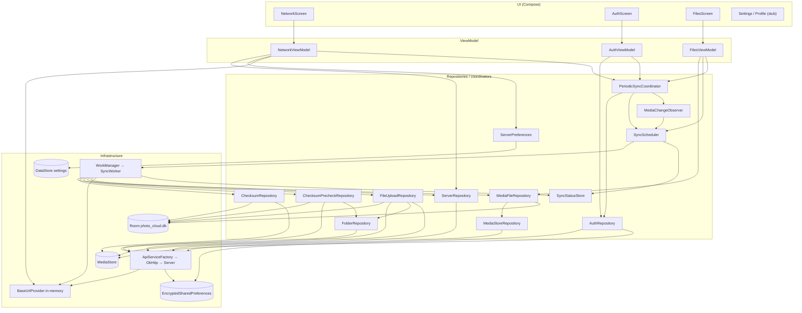

# 01. System Overview

> Аудит As-Is Android-клиента PhotoCloud. Дата: 2026-09-10, HEAD `2b9ab69`.
> Пути — относительно `app/src/main/java/ru/tbcarus/photo_cloud_client/`. Метки — см. [00-executive-summary.md](00-executive-summary.md).

---

## 1. Клиент как целостная система

**[CONFIRMED]** Приложение — один Android-процесс (одно Activity `MainActivity`, один `Application` `App`) с тремя контурами:

1. **Интерактивный контур** — Compose UI + ViewModel. Нужен для настройки (сервер, вход, разрешение) и наблюдения за состоянием.
2. **Контур синхронизации** — `SyncWorker` под управлением WorkManager. Выполняет pipeline scan → checksum → pre-check → upload.
3. **Контур триггеров** — `PeriodicSyncCoordinator` включает/выключает периодическую работу и `MediaChangeObserver`, а observer ставит one-time sync при изменении галереи.

Контуры связаны общими `@Singleton`-объектами внутри процесса (`BaseUrlProvider`, `SyncStatusStore`, репозитории с `Mutex`) и общей Room-БД.

## 2. Пользовательские сценарии (фактические)

| # | Сценарий | Точка входа | Результат |
| --- | --- | --- | --- |
| U1 | Настроить сервер | Network → IP, Port → «Test» | `GET /api/v1/test`; при успехе IP/порт сохраняются в DataStore, `baseUrl` становится `http://IP:PORT/` |
| U2 | Зарегистрироваться | Login → Email, Password → «Register» | `POST /auth/register`; в диалоге сообщение сервера («Email was sent») |
| U3 | Войти | Login → «Login» | `POST /auth/login`; токены в зашифрованном хранилище; вызов `reconcile()`; UI показывает email из JWT |
| U4 | Проверить авторизацию | Login → «Test Auth» | `GET /api/v1/test/auth`; сообщение сервера в диалоге |
| U5 | Дать доступ к фото | Files (при наличии токенов и `baseUrl`) → системный диалог | `reconcile()` → periodic + observer; разовый UI-scan |
| U6 | Автозагрузка | Съёмка фото / раз в час | `SyncWorker` загружает новые фото в `CAMERA` |
| U7 | Наблюдать за синхронизацией | Files | Карточка итога, счётчики, список фото со статусами и причинами ошибок |
| U8 | Выйти | Login → «Logout» | `POST /auth/logout`, очистка токенов, отмена periodic, остановка observer |

**[CONFIRMED]** Сценариев «посмотреть загруженное», «скачать», «удалить», «повторить загрузку вручную», «запустить синхронизацию вручную», «сменить пароль», «настройки синхронизации» нет. Ручные кнопки Scan / Pre-check / Upload / Run sync удалены в коммите `6f21d79` (Stage 5J.2).

## 3. Границы ответственности клиента

| Клиент **делает** | Клиент **не делает** |
| --- | --- |
| Определяет набор файлов для синхронизации (DCIM, только изображения) | Не синхронизирует видео и файлы вне `DCIM/` |
| Считает SHA-256 и хранит его | Не сверяет свой checksum с checksum из ответа upload |
| Держит состояние синхронизации каждого файла (Room) | Не хранит `folderId`, серверное имя, `uploadedAt`, привязку к аккаунту или серверу |
| Решает, нужен ли upload (pre-check по `CAMERA`) | Не выполняет обратную синхронизацию (`GET /files`) |
| Загружает файлы и сохраняет `serverFileId` | Не заполняет `serverFileId` для файлов, признанных существующими на pre-check |
| Повторяет transient-ошибки через WorkManager | Не повторяет permanent-ошибки и не даёт повторить их вручную |
| Удаляет из индекса файлы, исчезнувшие из MediaStore | Не сообщает серверу об удалении и не удаляет ничего на сервере |

## 4. Взаимодействие с Android OS

| Механизм ОС | Использование | Код |
| --- | --- | --- |
| Runtime permissions | `READ_MEDIA_IMAGES` (API 33+) / `READ_EXTERNAL_STORAGE` (API ≤ 32, `maxSdkVersion=32`) | `AndroidManifest.xml:6-9`, `ui/screens/FilesScreen.kt:47-83` |
| MediaStore (ContentResolver) | query по Images, `openInputStream` для checksum и upload | `media/MediaStoreRepository.kt:61`, `media/ChecksumRepository.kt:106`, `media/ContentUriRequestBody.kt:31` |
| ContentObserver | подписка на `Images.Media.EXTERNAL_CONTENT_URI`, `notifyForDescendants = true` | `media/MediaChangeObserver.kt:48-57` |
| WorkManager (поверх JobScheduler) | one-time и periodic `SyncWorker`; инициализация по требованию через `Configuration.Provider` | `App.kt:10-19`, `AndroidManifest.xml:37-41` |
| Android Keystore | MasterKey AES256-GCM для `EncryptedSharedPreferences` | `core/storage/EncryptedPrefsTokenStorage.kt:14-23` |
| DataStore | файл `settings` (IP, порт) | `core/server/ServerPreferences.kt:13` |
| Network Security Config | cleartext разрешён для `10.0.2.2`, `localhost` | `res/xml/network_security_config.xml` |
| Auto Backup | `allowBackup="true"`, правила-заглушки (исключений нет) | `AndroidManifest.xml:12-14` |

**[CONFIRMED]** Foreground service, уведомлений, `BOOT_COMPLETED`-ресивера, `setExpedited`/`setForeground` нет.

## 5. Взаимодействие с MediaStore

**[CONFIRMED]** MediaStore — единственный источник локальных файлов. Клиент:
- читает 8 колонок (`_ID`, `DISPLAY_NAME`, `RELATIVE_PATH`, `MIME_TYPE`, `SIZE`, `DATE_TAKEN`, `DATE_MODIFIED`, `DATE_ADDED`);
- строит URI `content://media/external/images/media/<_ID>`;
- никогда не пишет в MediaStore.

Единственный ключ идентичности файла между сканами — `_ID` (`mediaStoreId`). Подробно — [07-local-media-storage.md](07-local-media-storage.md).

## 6. Взаимодействие с сервером

**[CONFIRMED]** Протокол — HTTP/JSON (upload — multipart) на `http://<IP>:<PORT>/api/v1/...`. Используемые операции:

| Группа | Эндпоинты |
| --- | --- |
| Диагностика | `GET /test`, `GET /test/auth` |
| Auth | `POST /auth/register`, `/auth/login`, `/auth/refresh-token`, `/auth/logout` |
| Папки | `GET /folders/root`, `GET /folders/{id}/children` |
| Файлы | `POST /files/checksums/exists`, `POST /files/upload` |

Сервер для клиента — «оракул существования checksum в папке + приёмник байтов». Состояние синхронизации целиком принадлежит клиенту, что соответствует `04-media-data-contract.md` §10.

## 7. Локальные данные

### 7.1. Persistent state (переживает перезапуск процесса)

| Хранилище | Физически | Содержимое | Владелец |
| --- | --- | --- | --- |
| Room | `databases/photo_cloud.db` | таблица `media_files` — индекс локальных фото и их sync-статус | `core/db/AppDatabase.kt` |
| EncryptedSharedPreferences | `shared_prefs/secure_tokens.xml` | `accessToken`, `refreshToken` (зашифрованы) | `core/storage/EncryptedPrefsTokenStorage.kt` |
| DataStore Preferences | `files/datastore/settings.preferences_pb` [INFERRED путь по умолчанию] | `ip`, `port` | `core/server/ServerPreferences.kt` |
| WorkManager DB | внутренняя БД библиотеки | очереди `photo_sync`, `photo_sync_periodic`, их backoff и output | `media/SyncScheduler.kt` |

### 7.2. Transient state (только в памяти процесса)

| Состояние | Где | Последствие потери |
| --- | --- | --- |
| `baseUrl` | `di/BaseUrlProvider.kt:8` | **[RISK]** Все сетевые вызовы и `SyncWorker` не работают, пока `NetworkViewModel` не восстановит URL из DataStore, то есть пока пользователь не откроет UI |
| Итог последнего sync | `media/SyncStatusStore.kt:17` | Карточка на Files пропадает после перезапуска |
| Регистрация `ContentObserver` | `media/MediaChangeObserver.kt:40` | После гибели процесса observer не слушает галерею до следующего `reconcile()` |
| `debounceJob` | `media/MediaChangeObserver.kt:39` | Событие в пределах 3 с может потеряться |
| `Mutex` репозиториев checksum / pre-check / upload | `media/*Repository.kt` | Защищают только внутри одного процесса |
| UI-состояния (`AuthUiState`, `NetworkUiState`, `FilesUiState`) | ViewModel | Пересоздаются; пароль в `AuthUiState.password` живёт в памяти до уничтожения ViewModel |
| `tokensFlow` | `core/storage/EncryptedPrefsTokenStorage.kt:25` | Инициализируется из prefs при создании |

## 8. Схема слоёв (по фактической структуре)

```
Android UI (Compose)
  MainActivity → MainScreen → NavigationGraph
  NetworkScreen · AuthScreen · FilesScreen · SettingsScreen(stub) · ProfileScreen(stub)
        ↓ collectAsState / вызовы методов
ViewModel / presentation layer
  NetworkViewModel · AuthViewModel · FilesViewModel
        ↓
Repositories / coordinators (singletons; use-case слоя нет)
  auth/AuthRepository · core/server/ServerRepository, ServerPreferences
  media/MediaFileRepository · MediaStoreRepository · ChecksumRepository
  media/ChecksumPrecheckRepository · FolderRepository · FileUploadRepository
  media/SyncScheduler · PeriodicSyncCoordinator · MediaChangeObserver · SyncStatusStore
        ↓
Room (MediaFileDao) · MediaStore (ContentResolver) · API (ApiServiceFactory → Retrofit/OkHttp)
WorkManager (SyncWorker) · EncryptedSharedPreferences · DataStore
```


