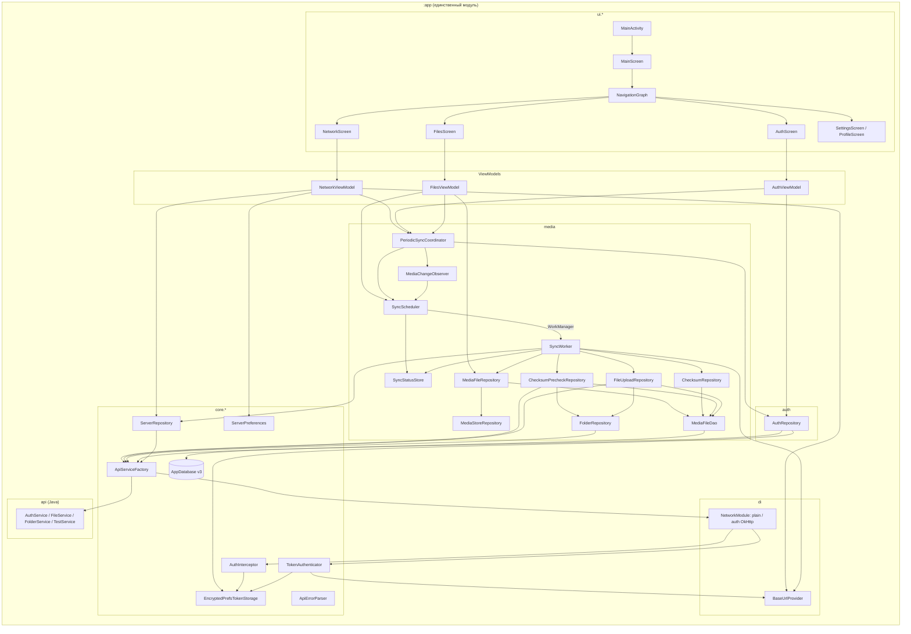

# 02. Architecture

> Аудит As-Is Android-клиента PhotoCloud. Дата: 2026-09-10, HEAD `2b9ab69`.
> Пути — относительно `app/src/main/java/ru/tbcarus/photo_cloud_client/`. Метки — см. [00-executive-summary.md](00-executive-summary.md).

---

## 1. Архитектурный стиль

**[CONFIRMED]** MVVM на Jetpack Compose + Hilt:

- экраны — `@Composable`-функции, подписанные на `StateFlow<UiState>` через `collectAsState()`;
- ViewModel — `@HiltViewModel`, хранят `MutableStateFlow<…UiState>`, вызывают репозитории в `viewModelScope`;
- репозитории — `@Singleton`-классы с `suspend`-методами. Результаты возвращаются как `kotlin.Result` (auth, server) или как sealed-интерфейсы `…Outcome` (media);
- фон — `@HiltWorker CoroutineWorker`.

**[CONFIRMED]** Domain / use-case слоя нет. Роль оркестратора синхронизации играет `SyncWorker`. Бизнес-правила переходов статусов распределены по трём репозиториям и DAO.

## 2. Gradle-модули

| Модуль | Назначение |
| --- | --- |
| `:app` | всё приложение (`settings.gradle.kts:23`) |

**[CONFIRMED]** Других модулей нет. `gradle/libs.versions.toml` объявляет каталог версий, но `app/build.gradle.kts` использует **захардкоженные** координаты зависимостей. Версии в каталоге не совпадают с фактическими: `coreKtx 1.16.0` в каталоге против `1.13.1` в app, `lifecycleRuntimeKtx 2.9.1` против `2.8.1`, `activityCompose 1.10.1` против `1.9.0`. Каталог используется только для плагинов в корневом `build.gradle.kts`.

**[CONFIRMED]** Лишний файл `app/AndroidManifest.xml` вне `src/main` (ссылается на несуществующую тему `Theme.PhotoCloudClient`) — **[INFERRED]** в сборку не попадает: стандартный sourceSet использует `src/main/AndroidManifest.xml`.

## 3. Пакеты

| Пакет | Назначение | Состав |
| --- | --- | --- |
| `(root)` | точки входа | `App`, `MainActivity` |
| `api` | Retrofit-интерфейсы (Java) и пути | `ApiPaths`, `AuthService`, `FileService`, `FolderService`, `TestService` |
| `api.models` | DTO | 3 Java-класса запросов, 7 Kotlin data class |
| `auth` | auth-репозиторий и UI-state | `AuthRepository`, `AuthUiState` |
| `core.db` | Room | `AppDatabase` (+ `Converters`, миграции) |
| `core.network` | сетевой каркас | `ApiServiceFactory`, `AuthInterceptor`, `TokenAuthenticator`, `ApiErrorParser` |
| `core.server` | адрес сервера | `ServerPreferences` (DataStore), `ServerRepository` (ping) |
| `core.storage` | токены | `TokenStorage`, `EncryptedPrefsTokenStorage`, `Tokens` |
| `di` | Hilt-модули | `AppModule`, `NetworkModule`, `StorageModule`, `BaseUrlProvider` |
| `media` | **вся синхронизация** | entity, DAO, enum-ы, 6 репозиториев, `SyncWorker`, `SyncScheduler`, `PeriodicSyncCoordinator`, `MediaChangeObserver`, `SyncStatusStore`, модели результатов |
| `ui` | корневой экран | `MainScreen` |
| `ui.components` | общие компоненты | навигация, диалоги, `ConnectionStatus` |
| `ui.screens` | экраны | `FilesScreen`, `NetworkScreen`, `ProfileScreen`, `SettingsScreen`, `StubComponents` |
| `ui.screens.auth / files / network` | экран + ViewModel + UiState | `AuthScreen`/`AuthViewModel`; `FilesViewModel`/`FilesUiState`; `NetworkViewModel`/`NetworkUiState` |
| `ui.theme` | Material3-тема | `Theme`, `Color`, `Type` |
| `utils` | утилиты | `JwtUtils`, `Routes`, `isValidIpAddress` |

## 4. Слои

### 4.1. UI layer

| | |
| --- | --- |
| Ответственность | отрисовка, runtime permission request, навигация |
| Ключевые классы | `MainActivity`, `MainScreen`, `NavigationGraph`, `BottomNavigationBar`, 5 экранов, `LoadingDialog`, `showDialog` |
| Зависимости | ViewModel через `hiltViewModel()`; `NetworkViewModel` создаётся на уровне Activity (`MainActivity.kt:17`) и передаётся вниз |
| Состояние | локальное Compose-состояние отсутствует, кроме `remember` для permission-строки и launcher |

**[CONFIRMED] Логика в UI:**
- `FilesScreen` сам проверяет разрешение через `ContextCompat.checkSelfPermission` и решает, запрашивать ли его или вызвать `ensureAutoSyncStarted()` (`ui/screens/FilesScreen.kt:73-83`). Это bootstrap автосинхронизации внутри Composable.
- Счётчики по статусам вычисляются в Composable на каждой рекомпозиции (`FilesScreen.kt:216-236`).
- Форматирование статусов и причин (`FilesScreen.kt:258-298`) — допустимая презентационная логика.

### 4.2. ViewModels

| ViewModel | Scope | Зависимости | Состояние | Ответственность |
| --- | --- | --- | --- | --- |
| `NetworkViewModel` | Activity (`MainActivity.kt:17`) | `BaseUrlProvider`, `ServerPreferences`, `ServerRepository`, `PeriodicSyncCoordinator` | `NetworkUiState(ip, port, isLoading, message, connectionStatus)` | Восстанавливает `baseUrl` из DataStore при старте, ping, сохранение, **первый `reconcile()` за жизнь процесса** |
| `AuthViewModel` | NavBackStackEntry `auth` | `AuthRepository`, `PeriodicSyncCoordinator` | `AuthUiState(email, password, status, message, isLoggedIn, userEmail, isVerifying)` | register/login/logout/testAuth, `verifySession()` при создании, `reconcile()` после login/logout |
| `FilesViewModel` | NavBackStackEntry `files` | `MediaFileRepository`, `SyncScheduler`, `PeriodicSyncCoordinator` | `FilesUiState(files, isScanning, lastScanResult, permissionDenied, errorMessage, isSyncing, lastSyncStatus)` | Подписка на Room, WorkManager и `SyncStatusStore`; UI-scan после выдачи разрешения |

**[CONFIRMED]** `NetworkViewModel` одновременно отвечает за конфигурацию сервера и за **глобальную инициализацию** (восстановление `baseUrl` + `reconcile()`). Инициализация приложения привязана к UI-объекту. Это корень риска R-BG-1 (см. 16).

**[CONFIRMED]** `FilesViewModel.clearMessages()` — **[UNUSED]**.

### 4.3. Domain / use-case layer

**[CONFIRMED]** Отсутствует. Функции use-case выполняют `SyncWorker.runSync()` (порядок стадий) и `PeriodicSyncCoordinator.reconcile()` (правило включения автосинхронизации).

### 4.4. Repository layer

| Класс | Ответственность | Зависимости | Состояние |
| --- | --- | --- | --- |
| `AuthRepository` | register/login/logout/testAuth, фасад над `TokenStorage` | `TokenStorage`, `BaseUrlProvider`, `ApiServiceFactory` | нет |
| `ServerRepository` | `GET /api/v1/test` по переданному baseUrl | `ApiServiceFactory` | нет |
| `ServerPreferences` | чтение/запись IP и порта | DataStore | нет |
| `MediaStoreRepository` | чтение MediaStore → `List<MediaStoreImage>` | `Context` | нет |
| `MediaFileRepository` | применение скана к Room (insert / reset / update / stale delete), `observeAll()` | `MediaFileDao`, `MediaStoreRepository` | нет (**без Mutex**) |
| `ChecksumRepository` | SHA-256 для `PENDING`, recovery `HASHING`, auto-retry `CHECKSUM_IO` | `MediaFileDao`, `Context` | `Mutex` |
| `FolderRepository` | поиск `CAMERA` через root → children | `ApiServiceFactory` | нет (кэш — TODO) |
| `ChecksumPrecheckRepository` | batch pre-check `CHECKSUM_READY` → `SYNCED`/`PENDING_UPLOAD` | `MediaFileDao`, `ApiServiceFactory`, `FolderRepository` | `Mutex` |
| `FileUploadRepository` | upload `PENDING_UPLOAD`, recovery `UPLOADING` | `MediaFileDao`, `ApiServiceFactory`, `FolderRepository`, `Context` | `Mutex` |

**[CONFIRMED] Границы репозиториев:**
- `MediaFileDao` напрямую используют 4 репозитория. Колонку `status` меняют `MediaFileRepository`, `ChecksumRepository`, `ChecksumPrecheckRepository`, `FileUploadRepository`. Единого владельца state machine нет.
- `ChecksumRepository.restoreRetryableFailed()` отвечает за retry-политику, хотя `FailureReason` относится ко всему pipeline.
- Проверка media-разрешения продублирована 4 раза: `MediaStoreRepository.kt:34-41`, `ChecksumRepository.kt:65-73`, `PeriodicSyncCoordinator.kt:52-60`, `FilesScreen.kt:47-53`.

### 4.5. Координаторы и планировщики (пакет `media`)

| Класс | Ответственность | Состояние |
| --- | --- | --- |
| `SyncScheduler` | enqueue/cancel WorkManager, `observeIsSyncing()` (только `photo_sync`) | нет |
| `PeriodicSyncCoordinator` | правило «токены + baseUrl + разрешение» → periodic + observer | нет |
| `MediaChangeObserver` | `ContentObserver` + debounce 3 с → `enqueueOneTimeSync()` | `registered`, `debounceJob`, собственный `CoroutineScope` |
| `SyncStatusStore` | in-memory итог последнего прогона | `MutableStateFlow<SyncStatusRecord?>` |

**[CONFIRMED]** `PeriodicSyncCoordinator` (пакет `media`) зависит от `auth.AuthRepository`, то есть от auth-слоя. `AuthRepository` ничего не знает о sync. Поэтому AuthViewModel вынужден вызывать `reconcile()` вручную после login/logout, а `TokenAuthenticator` при очистке токенов его **не** вызывает.

### 4.6. Network

| Класс | Ответственность |
| --- | --- |
| `NetworkModule` | два `OkHttpClient` (`@Named("plain")`, `@Named("auth")`) и `HttpLoggingInterceptor(BODY)` |
| `ApiServiceFactory` | собирает `Retrofit` на **каждый** вызов `xxxService()` по текущему `baseUrl`; падает `IllegalStateException`, если URL пуст |
| `AuthInterceptor` | добавляет `Authorization: Bearer <access>`, если токены есть |
| `TokenAuthenticator` | refresh на `401`, отдельный Retrofit на plain-клиенте |
| `ApiErrorParser` | превращает error body в строку |
| `api/*.java` | Retrofit-интерфейсы с `Call<T>` (не `suspend`) |

**[CONFIRMED]** Retrofit-интерфейсы на Java возвращают `Call<T>`, вызываются через блокирующий `execute()` внутри `withContext(Dispatchers.IO)`. Блокирующие вызовы не прерываются отменой корутины. Последствия — в [12-background-jobs.md](12-background-jobs.md).

### 4.7. Room

`AppDatabase` (v3, одна entity), `MediaFileDao` (21 метод, из них 5 не используются). DAO и entity лежат в пакете `media`, БД — в `core.db`. `AppDatabase.getInstance()` — ручной double-checked singleton; Hilt дополнительно оборачивает его в `@Singleton` (`di/AppModule.kt:17-20`). Подробно — [04-database.md](04-database.md).

### 4.8. Background workers

Один worker — `SyncWorker`. Подробно — [12-background-jobs.md](12-background-jobs.md).

### 4.9. DI (Hilt)

| Модуль / класс | Что предоставляет | Scope |
| --- | --- | --- |
| `AppModule` | `AppDatabase`, `MediaFileDao` | Singleton |
| `NetworkModule` | `HttpLoggingInterceptor`, `OkHttpClient` plain, `OkHttpClient` auth | Singleton |
| `StorageModule` | `TokenStorage` ← `EncryptedPrefsTokenStorage` (`@Binds`) | Singleton |
| `BaseUrlProvider` | `@Singleton @Inject constructor` | Singleton |
| `AuthInterceptor`, `TokenAuthenticator` | `@Inject constructor`, **без scope** | фактически один экземпляр, потому что внедряются в singleton-клиент |
| Репозитории, координаторы | `@Singleton @Inject constructor` | Singleton |
| ViewModels | `@HiltViewModel` | ViewModel |
| `SyncWorker` | `@HiltWorker` + `@AssistedInject`, фабрика `HiltWorkerFactory` в `App` | per-run |

**[CONFIRMED]** WorkManager инициализируется по требованию. В манифесте удалён **весь** `androidx.startup.InitializationProvider` (`AndroidManifest.xml:37-41`). **[INFERRED]** Это отключает все App Startup-инициализаторы, а не только WorkManager (например, ProfileInstaller). Функционально критичных последствий в текущем коде не обнаружено.

### 4.10. Utilities

| Утилита | Использование |
| --- | --- |
| `JwtUtils.getSubject` | email пользователя для UI (`AuthViewModel.kt:32-34`) |
| `JwtUtils.isExpired` | **[UNUSED]** |
| `isValidIpAddress` | валидация IPv4 (`NetworkViewModel.kt:53`) |
| `Routes` | имена маршрутов |
| `ChecksumUtil.sha256` (пакет `media`) | чистая функция, без Android-зависимостей |

## 5. Архитектурные проверки

| Проверка | Результат |
| --- | --- |
| Бизнес-логика в UI | **[CONFIRMED]** bootstrap автосинка и permission-решение в `FilesScreen` (`FilesScreen.kt:58-83`). Остальное — презентация |
| Android framework в неподходящих слоях | **[CONFIRMED]** `ConnectionStatus` (enum с `androidx.compose.ui.graphics.Color`) используется как поле статуса в `auth/AuthUiState` и `NetworkUiState`: модель состояния зависит от Compose-типа. Репозитории используют `Context`/`ContentResolver` — ожидаемо для Android-data-слоя |
| Границы репозиториев | **[CONFIRMED]** 4 репозитория пишут статусы в одну таблицу; retry-логика в `ChecksumRepository`; `FolderRepository` вызывается дважды за прогон (pre-check и upload), кэша нет |
| Дублирование state | **[CONFIRMED]** (1) `baseUrl` — в DataStore и в памяти (`BaseUrlProvider`), синхронизируется только из `NetworkViewModel`; (2) «идёт синхронизация» — `WorkInfo` только для `photo_sync`, periodic в UI не отражается; (3) итог sync — в памяти (`SyncStatusStore`) и частично в `WorkInfo.outputData` (только при успехе); (4) проверка разрешения — 4 копии; (5) `AppDatabase` — ручной singleton плюс Hilt singleton |
| Слоистость `media` | **[CONFIRMED]** В одном пакете лежат entity, DAO, enum-ы, репозитории, WorkManager-worker, планировщик, observer и модели результатов. Разделения data / domain / background нет |
| Смешение Java/Kotlin | **[CONFIRMED]** 4 интерфейса и 3 DTO на Java, остальное на Kotlin |

## 6. Архитектурная диаграмма

