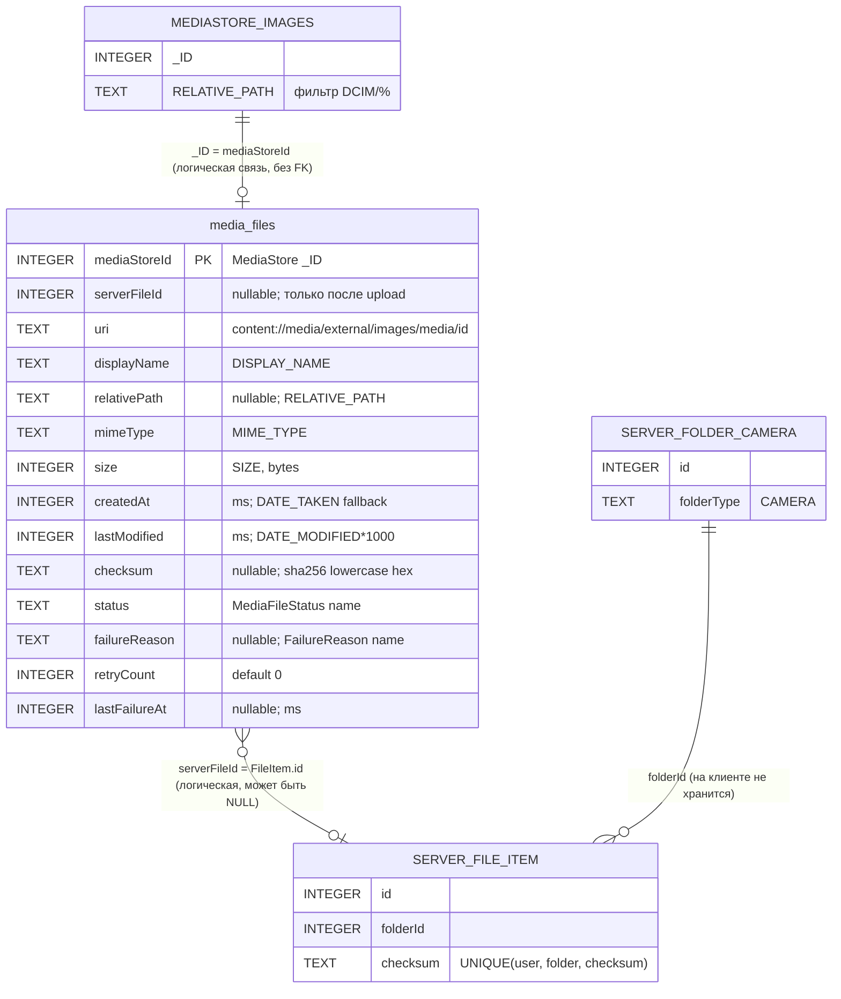

# 04. Database (Room)

> Аудит As-Is Android-клиента PhotoCloud. Дата: 2026-09-10, HEAD `2b9ab69`.
> Пути — относительно `app/src/main/java/ru/tbcarus/photo_cloud_client/`. Метки — см. [00-executive-summary.md](00-executive-summary.md).

---

## 1. Общие параметры

| Параметр | Значение | Источник |
| --- | --- | --- |
| Библиотека | Room 2.7.0 (runtime, ktx, KSP compiler) | `app/build.gradle.kts:79-81` |
| Класс БД | `AppDatabase` | `core/db/AppDatabase.kt:16-18` |
| Файл | `photo_cloud.db` | `core/db/AppDatabase.kt:63` |
| Версия | **3** | `core/db/AppDatabase.kt:16` |
| Entities | `[MediaFile]` — одна таблица | `core/db/AppDatabase.kt:16` |
| `exportSchema` | `true`; каталог `app/schemas` | `core/db/AppDatabase.kt:16`, `app/build.gradle.kts:101-103` |
| Экспортированные схемы | `2.json`, `3.json` (**`1.json` нет**) | `app/schemas/ru.tbcarus.photo_cloud_client.core.db.AppDatabase/` |
| Миграции | `MIGRATION_1_2`, `MIGRATION_2_3` | `core/db/AppDatabase.kt:38-53` |
| Destructive fallback | `fallbackToDestructiveMigration(dropAllTables = true)` | `core/db/AppDatabase.kt:68` |
| Создание | ручной singleton `getInstance()` (double-checked locking) + Hilt `@Singleton` provider | `core/db/AppDatabase.kt:55-71`, `di/AppModule.kt:17-24` |
| `@Transaction` / `withTransaction` | **не используются** | grep по проекту |
| Индексы | **нет** | `3.json` |

## 2. Entity `media_files`

По `3.json` (`createSql`) и `media/MediaFile.kt`:

| # | Колонка | SQLite affinity | NOT NULL | SQL DEFAULT (свежая установка) | Kotlin default | Converter | Категория |
| --- | --- | --- | --- | --- | --- | --- | --- |
| 1 | `mediaStoreId` | INTEGER | ✅ | — | — | — | **PK** |
| 2 | `serverFileId` | INTEGER | ❌ | — | `null` | — | SERVER |
| 3 | `uri` | TEXT | ✅ | — | — | — | LOCAL |
| 4 | `displayName` | TEXT | ✅ | — | — | — | LOCAL |
| 5 | `relativePath` | TEXT | ❌ | — | — | — | LOCAL |
| 6 | `mimeType` | TEXT | ✅ | — | — | — | LOCAL |
| 7 | `size` | INTEGER | ✅ | — | — | — | LOCAL |
| 8 | `createdAt` | INTEGER | ✅ | — | — | — | LOCAL |
| 9 | `lastModified` | INTEGER | ✅ | — | — | — | LOCAL |
| 10 | `checksum` | TEXT | ❌ | — | — | — | DERIVED |
| 11 | `status` | TEXT | ✅ | — | `PENDING` | `MediaFileStatus` ↔ `name` | SYNC_STATE |
| 12 | `failureReason` | TEXT | ❌ | — | `null` | `FailureReason?` ↔ `name?` | SYNC_STATE |
| 13 | `retryCount` | INTEGER | ✅ | — | `0` | — | SYNC_STATE |
| 14 | `lastFailureAt` | INTEGER | ❌ | — | `null` | — | SYNC_STATE |

**[CONFIRMED]** Kotlin-defaults в SQL не попадают: `@ColumnInfo(defaultValue)` не используется. SQL-`DEFAULT` есть только у колонок, добавленных миграциями: `displayName DEFAULT ''`, `lastModified DEFAULT 0`, `retryCount DEFAULT 0`. **[INFERRED]** DDL свежей установки и мигрированной БД поэтому различаются. Room это допускает, потому что default в entity не задан.

### 2.1. Ключи и уникальность

- **PK:** `mediaStoreId` (`autoGenerate = false`). Уникальность — только по PK.
- **Индексы:** отсутствуют. Все выборки фильтруют по `status` и сортируют по `createdAt DESC` полным сканом таблицы. **[INFERRED]** Для библиотек в десятки тысяч фото это O(N) на каждый batch-запрос.
- **Уникальности по `checksum` нет:** несколько локальных копий одного фото — отдельные строки с одинаковым checksum. Pre-check их группирует (`ChecksumPrecheckRepository.kt:91-92`).
- **FK нет:** связь с MediaStore (`_ID`) и сервером (`FileItem.id`) только логическая.

### 2.2. Type converters

`AppDatabase.Converters` (`core/db/AppDatabase.kt:22-34`):

| Converter | Направление | Риск |
| --- | --- | --- |
| `fromStatus` / `toStatus` | `MediaFileStatus.name` ↔ `valueOf(value)` | **[RISK]** неизвестное значение (например, после отката APK) бросит `IllegalArgumentException` при чтении |
| `fromFailureReason` / `toFailureReason` | `name?` ↔ `valueOf?` | то же |

**[CONFIRMED]** Часть SQL использует строковые литералы вместо параметров: `'FAILED'` (`MediaFileDao.kt:51, 65`), `'PENDING'` (`MediaFileDao.kt:85`), `'SYNCED'` (`MediaFileDao.kt:117`). Переименование констант enum сломает эти запросы без ошибки компиляции.

## 3. DAO `MediaFileDao`

**Файл:** `media/MediaFileDao.kt`. 21 метод, 5 не используются.

| Метод | Тип | SQL / действие | Вызывающие | Статус |
| --- | --- | --- | --- | --- |
| `insert(file)` | `@Insert(IGNORE)` | вставка одной строки | — | **[UNUSED]** |
| `insertAll(files)` | `@Insert(IGNORE)` | вставка, существующие PK игнорируются | `MediaFileRepository.applyToRoom:38` | используется |
| `getAll()` | `Flow<List>` | `SELECT * … ORDER BY createdAt DESC` | `MediaFileRepository.observeAll` → `FilesViewModel` | используется |
| `getByStatus(status)` | `Flow<List>` | `WHERE status = :status` | только `getPending()` | **[UNUSED]** косвенно |
| `getPending()` | default-метод | `getByStatus(PENDING)` | — | **[UNUSED]** |
| `updateStatus(id, status)` | UPDATE | `SET status` | checksum (`→ HASHING`), upload (`→ UPLOADING`, `→ PENDING_UPLOAD`) | используется |
| `updateChecksum(id, checksum, status = CHECKSUM_READY)` | UPDATE | `SET checksum, status, failureReason=NULL, retryCount=0, lastFailureAt=NULL` | `ChecksumRepository:115` | используется |
| `markFailed(id, reason, failureAt)` | UPDATE | `SET status='FAILED', failureReason, retryCount=retryCount+1, lastFailureAt` | checksum (4 места), upload (3 места) | используется |
| `getRetryableFailed(reason, maxRetryCount, retryBefore, limit)` | SELECT | `status='FAILED' AND failureReason=:reason AND retryCount<:max AND lastFailureAt<=:retryBefore ORDER BY createdAt DESC LIMIT` | `ChecksumRepository.restoreRetryableFailed:47` | используется |
| `resetFailedForRetry(id)` | UPDATE | `SET status='PENDING', failureReason=NULL, lastFailureAt=NULL` (**retryCount сохраняется**) | `ChecksumRepository:54` | используется |
| `updateLocalMetadata(id, …)` | UPDATE | `SET displayName, relativePath, mimeType, size, createdAt, lastModified, uri` | `MediaFileRepository:52` | используется |
| `markUploaded(id, serverFileId)` | UPDATE | `SET status='SYNCED', serverFileId, failureReason=NULL, retryCount=0, lastFailureAt=NULL` | `FileUploadRepository:115` | используется |
| `exists(id)` | SELECT COUNT | — | — | **[UNUSED]** |
| `getAllMediaStoreIds()` | SELECT | все PK | `MediaFileRepository:65` | используется |
| `deleteByMediaStoreIds(ids)` | DELETE | `WHERE mediaStoreId IN (…)` | `MediaFileRepository:72` (чанки по 500) | используется |
| `getByStatusOnce(status, limit)` | SELECT | `WHERE status ORDER BY createdAt DESC LIMIT` | checksum (`PENDING`, 100), upload (`PENDING_UPLOAD`, 20) | используется |
| `resetStatus(source, target)` | UPDATE | `SET status=:target WHERE status=:source` | checksum (`HASHING→PENDING`), upload (`UPLOADING→PENDING_UPLOAD`) | используется |
| `resetChecksumIfFileChanged(id, size, lastModified, status = PENDING)` | UPDATE | `SET checksum=NULL, serverFileId=NULL, status, failureReason=NULL, retryCount=0, lastFailureAt=NULL WHERE id AND (size != :size OR lastModified != :lastModified)` | `MediaFileRepository:47` | используется |
| `getLatestCreatedAt()` | SELECT MAX | — | — | **[UNUSED]** |
| `getByStatusWithChecksumOnce(status, limit)` | SELECT | `… AND checksum IS NOT NULL … LIMIT` | pre-check (`CHECKSUM_READY`, 500) | используется |
| `updateStatusByMediaStoreIds(ids, status)` | UPDATE | `WHERE mediaStoreId IN (…)` | pre-check (чанки по 500) | используется |

### 3.1. Транзакционность

**[CONFIRMED]** Ни один DAO-метод не помечен `@Transaction`; `withTransaction` не используется. Следствия:

- Scan — это `insertAll` + N пар (`resetChecksumIfFileChanged` + `updateLocalMetadata`) + `getAllMediaStoreIds` + пачки `DELETE`, каждое в своей неявной транзакции. TODO в `MediaFileRepository.kt:22` признаёт это. Прерванный scan оставляет частично обновлённый индекс. **[INFERRED]** Это безопасно: следующий scan идемпотентно доводит состояние.
- Каждая строка — отдельный `UPDATE` (N+1 на скан из N фото), плюс `Flow getAll()` переэмитит всю таблицу после каждой записи. **[INFERRED]** На большой библиотеке это нагрузка на UI при открытом экране Files.
- Атомарность отдельных переходов обеспечена одиночными `UPDATE` (например, `markFailed` инкрементирует `retryCount` в SQL).

## 4. История версий и миграций

Восстановлено по `git log` для `AppDatabase.kt` и `MediaFile.kt`:

| Версия | Коммит, дата | Схема `media_files` | Миграция / примечание |
| --- | --- | --- | --- |
| 1 (вариант A) | `a234a31` 2026-03-17 «Media file processing init» | `id` PK autoGenerate, `mediaStoreId`, … | `exportSchema = false` |
| 1 (вариант B) | `2621802` 2026-03-18 «Fix» | PK → `mediaStoreId` | **версия не повышена** |
| 1 (вариант C) | `282090a` 2026-03-23 «MediaFile refactor» | снова `id` PK (без autoGenerate) + `mediaStoreId` | **версия не повышена** |
| 1 (вариант D) | `227d6c1` 2026-05-26 «Fix & move» | PK `mediaStoreId`; поля `serverFileId, uri, mimeType, size, createdAt, checksum, status`; добавлен `fallbackToDestructiveMigration` | **версия не повышена**; БД перенесена в `core.db` |
| 2 | `4899c1a` 2026-05-28 «5B local files prepare» | + `displayName`, `relativePath`, `lastModified` | `MIGRATION_1_2`; включён `exportSchema` |
| 3 | `2b9ab69` 2026-09-10 «5K» | + `failureReason`, `retryCount`, `lastFailureAt` | `MIGRATION_2_3` |

**[CONFIRMED]** У версии 1 было 4 несовместимых варианта схемы при одном номере версии. `MIGRATION_1_2` (`AppDatabase.kt:38-44`) рассчитана только на вариант D. **[INFERRED]** На устройстве с БД варианта A/B/C Room сначала упадёт на проверке identity hash или валидации после миграции (`IllegalStateException`). `fallbackToDestructiveMigration` такие ошибки не перехватывает. Затрагивает только dev-установки до 2026-05-26.

### 4.1. `MIGRATION_1_2`

```sql
ALTER TABLE media_files ADD COLUMN displayName TEXT NOT NULL DEFAULT '';
ALTER TABLE media_files ADD COLUMN relativePath TEXT;
ALTER TABLE media_files ADD COLUMN lastModified INTEGER NOT NULL DEFAULT 0;
```

**[CONFIRMED]** Смысловое следствие: у мигрированных строк `lastModified = 0`. При первом скане после миграции `resetChecksumIfFileChanged` видит `lastModified != <реальное>` и **сбрасывает все строки** в `PENDING` с `checksum = NULL`, `serverFileId = NULL`. Итог: полный пересчёт SHA-256 и потеря `serverFileId` у ранее загруженных. **[INFERRED]** Файлы при этом повторно не загружаются: pre-check вернёт `existing` → `SYNCED` без `serverFileId`.

### 4.2. `MIGRATION_2_3`

```sql
ALTER TABLE media_files ADD COLUMN failureReason TEXT;
ALTER TABLE media_files ADD COLUMN retryCount INTEGER NOT NULL DEFAULT 0;
ALTER TABLE media_files ADD COLUMN lastFailureAt INTEGER;
```

**[CONFIRMED]** Строки, бывшие `FAILED` до 5K, получают `failureReason = NULL`, `lastFailureAt = NULL`. `getRetryableFailed` требует `failureReason = :reason AND lastFailureAt <= :retryBefore`, и `NULL` не проходит ни одно из условий. Эти строки **никогда не будут авто-повторены** и в UI отображаются как «Failed» без причины (`FilesScreen.kt:265`). Выйти из этого состояния они могут только через изменение файла или удаление строки.

### 4.3. Destructive migration

**[CONFIRMED]** `fallbackToDestructiveMigration(dropAllTables = true)`; TODO называет это временной мерой (`AppDatabase.kt:66-67`). **[INFERRED]** По поведению Room:
- срабатывает при отсутствии пути миграции между версиями (например, прямой переход с версии, для которой миграций нет);
- **не** срабатывает при downgrade: нужен `fallbackToDestructiveMigrationOnDowngrade`, а его нет. Откат APK на более старую версию БД приведёт к падению при открытии;
- при срабатывании уничтожается весь индекс, и следующий sync заново хэширует все фото. На сервере повторных загрузок не будет благодаря pre-check.

### 4.4. Schema export

**[CONFIRMED]** Экспорт включён с версии 2; `1.json` отсутствует, поэтому `MIGRATION_1_2` нельзя проверить инструментами Room (`MigrationTestHelper`). Тестов миграций нет (см. 13).

## 5. Status transitions на уровне DAO

| DAO-метод | Из статуса | В статус | Условие в SQL |
| --- | --- | --- | --- |
| `insertAll` | — (нет строки) | `PENDING` | PK отсутствует |
| `resetChecksumIfFileChanged` | **любой** | `PENDING` | `size` или `lastModified` отличаются |
| `resetStatus(HASHING, PENDING)` | `HASHING` | `PENDING` | все строки |
| `updateStatus(…, HASHING)` | `PENDING` (по выборке) | `HASHING` | по id |
| `updateChecksum` | `HASHING` | `CHECKSUM_READY` | по id |
| `markFailed` | `HASHING` / `PENDING_UPLOAD` / `UPLOADING` | `FAILED` | по id |
| `resetFailedForRetry` | `FAILED(CHECKSUM_IO)` | `PENDING` | по id из `getRetryableFailed` |
| `updateStatusByMediaStoreIds(…, SYNCED / PENDING_UPLOAD)` | `CHECKSUM_READY` (по выборке) | `SYNCED` / `PENDING_UPLOAD` | по списку id |
| `resetStatus(UPLOADING, PENDING_UPLOAD)` | `UPLOADING` | `PENDING_UPLOAD` | все строки |
| `updateStatus(…, UPLOADING / PENDING_UPLOAD)` | `PENDING_UPLOAD` / `UPLOADING` | `UPLOADING` / `PENDING_UPLOAD` | по id |
| `markUploaded` | `UPLOADING` | `SYNCED` | по id |
| `deleteByMediaStoreIds` | **любой** | (строка удалена) | id не найден в скане |

**[CONFIRMED]** Ни один UPDATE не проверяет текущий статус в `WHERE` (нет optimistic concurrency). Исходный статус гарантируется только выборкой и `Mutex` соответствующей стадии. Гонки описаны в [09-state-machines.md](09-state-machines.md) §5.

## 6. Retry-поля

| Поле | Инкремент/установка | Сброс | Используется |
| --- | --- | --- | --- |
| `retryCount` | `+1` в `markFailed` (любая причина) | `0` в `updateChecksum`, `markUploaded`, `resetChecksumIfFileChanged` | только в `getRetryableFailed` (`< 3`) для `CHECKSUM_IO` |
| `lastFailureAt` | `now` в `markFailed` | `NULL` в `updateChecksum`, `markUploaded`, `resetFailedForRetry`, `resetChecksumIfFileChanged` | cooldown (`<= now − 5 мин`) |
| `failureReason` | `markFailed` | `NULL` там же | фильтр retry; отображение в UI |

**[CONFIRMED]** `retryCount` считает **подряд идущие** неудачи: успешный checksum обнуляет счётчик. Для upload-причин (`HTTP_*`, `NOT_IMAGE`, `PERMISSION`, `FILE_NOT_FOUND`) счётчик растёт, но нигде не используется.

## 7. Изменение checksum

| Событие | Эффект | Код |
| --- | --- | --- |
| Успешный hashing | `checksum = <sha256>`, `status = CHECKSUM_READY` | `ChecksumRepository.kt:114-115` |
| Изменились `size`/`lastModified` | `checksum = NULL`, `serverFileId = NULL`, `status = PENDING` | `MediaFileDao.kt:155-171` |
| Иначе | checksum **не** пересчитывается: изменение содержимого без изменения `size` и `DATE_MODIFIED` не будет обнаружено | — |

## 8. Детекция изменения файла

**[CONFIRMED]** Выполняется только в scan (`MediaFileRepository.kt:47-51`) **до** `updateLocalMetadata` (порядок оговорён в KDoc `MediaFileDao.kt:149-152`). Критерий: `size != :size OR lastModified != :lastModified`. Сбрасывается любой статус, включая `SYNCED`, `UPLOADING` и `HASHING`. Последствия — в 07 §6 и 09 §5.

## 9. Механизмы reset

| Механизм | Где | Когда | Что делает |
| --- | --- | --- | --- |
| Recovery `HASHING` | `ChecksumRepository.runPipeline:88-91` | начало каждой checksum-стадии | `HASHING → PENDING` (все строки) |
| Recovery `UPLOADING` | `FileUploadRepository.runUpload:53-56` | начало каждой upload-стадии | `UPLOADING → PENDING_UPLOAD` (все строки) |
| Auto-retry `CHECKSUM_IO` | `ChecksumRepository.restoreRetryableFailed:45-57` | шаг 0 каждого `SyncWorker` (после ping) | `FAILED → PENDING` (≤ 500 строк за прогон) |
| Сброс по изменению файла | `MediaFileDao.resetChecksumIfFileChanged` | каждый scan | любой → `PENDING` |
| Stale-удаление | `MediaFileRepository.applyToRoom:65-74` | каждый scan | удаление строки |
| Destructive migration | `AppDatabase.kt:68` | нет пути миграции | удаление всех данных |
| Ручной reset / «очистить индекс» | — | — | **NOT FOUND** |
| Очистка при logout | — | — | **NOT FOUND** |

## 10. ER-диаграмма


