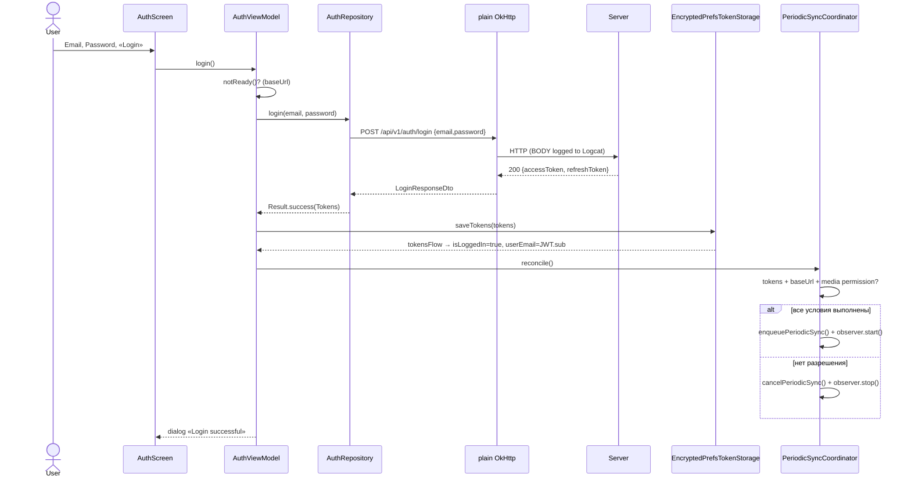
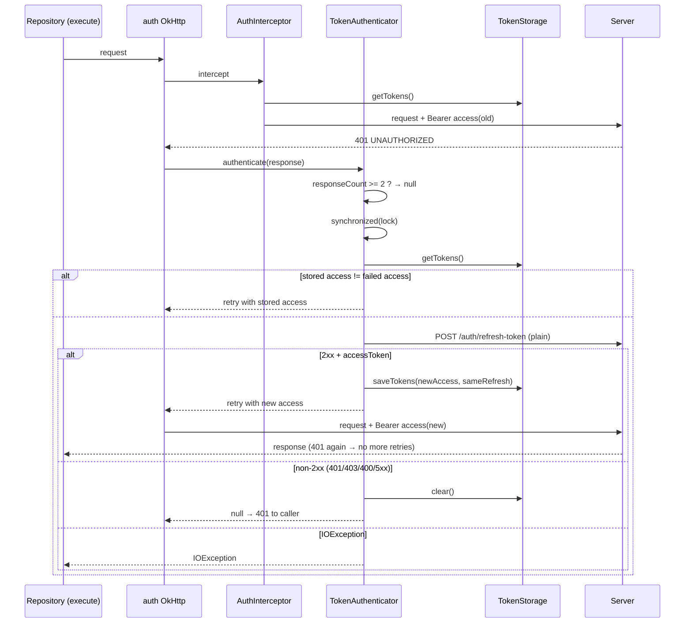
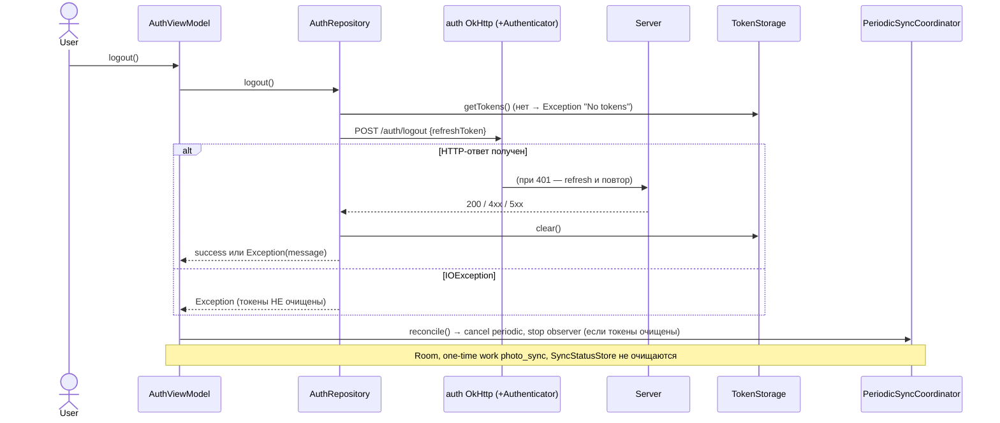

# 06. Auth & Security

> Аудит As-Is Android-клиента PhotoCloud. Дата: 2026-09-10, HEAD `2b9ab69`.
> Пути — относительно `app/src/main/java/ru/tbcarus/photo_cloud_client/`. Метки — см. [00-executive-summary.md](00-executive-summary.md).
> Эталон сравнения — `client-handoff/02-auth-contract.md`.

---

## 1. Компоненты

| Компонент | Файл | Роль |
| --- | --- | --- |
| `AuthScreen` | `ui/screens/auth/AuthScreen.kt` | форма email/пароль, кнопки Register / Login / Test Auth; после входа — email и Logout |
| `AuthViewModel` | `ui/screens/auth/AuthViewModel.kt` | действия, `isLoggedIn` из `tokensFlow`, `verifySession()` |
| `AuthRepository` | `auth/AuthRepository.kt` | register / login / logout / testAuth, фасад хранилища |
| `TokenStorage` / `EncryptedPrefsTokenStorage` | `core/storage/*` | хранение токенов, `StateFlow<Tokens?>` |
| `AuthInterceptor` | `core/network/AuthInterceptor.kt` | заголовок `Authorization: Bearer …` |
| `TokenAuthenticator` | `core/network/TokenAuthenticator.kt` | refresh на `401` |
| `JwtUtils` | `utils/JwtUtils.kt` | `getSubject()` для UI; `isExpired()` — **[UNUSED]** |
| `PeriodicSyncCoordinator` | `media/PeriodicSyncCoordinator.kt` | включение/выключение фонового sync по наличию токенов |

## 2. Auth lifecycle

### 2.1. Предусловие: адрес сервера

**[CONFIRMED]** Все auth-действия блокируются, пока `baseUrl` пуст: `AuthViewModel.notReady()` → «Адрес подключения не настроен» (`AuthViewModel.kt:52-57`). Это касается и **logout**: без настроенного сервера выйти (очистить токены) нельзя.

### 2.2. Login UI

**[CONFIRMED]** Одна форма для регистрации и входа (`AuthScreen.kt:55-91`).
- **[RISK]** Поле пароля — обычный `OutlinedTextField` без `PasswordVisualTransformation` и без `KeyboardType.Password` (`AuthScreen.kt:74-79`): пароль виден на экране и может попасть в подсказки клавиатуры.
- Клиентской валидации email и длины пароля (4–20) нет.
- «Test Auth» доступна и до входа.

### 2.3. Login request

`AuthViewModel.login()` → `AuthRepository.login()` → plain-клиент `POST /auth/login`. Ответ проверяется на непустые оба токена (`AuthRepository.kt:41-48`). При успехе:
1. `repo.saveTokens(tokens)` → prefs + `tokensFlow`;
2. `periodicSyncCoordinator.reconcile()`;
3. диалог «Login successful».

`isLoggedIn` и `userEmail` (JWT `sub`) обновляются реактивно из `tokensFlow` (`AuthViewModel.kt:27-38`).

### 2.4. Access token и refresh token: хранение

| Аспект | Факт |
| --- | --- |
| Физическое место | `shared_prefs/secure_tokens.xml` [INFERRED путь по умолчанию SharedPreferences] |
| Шифрование | `EncryptedSharedPreferences`: ключи — AES256-SIV, значения — AES256-GCM; `MasterKey` AES256-GCM в Android Keystore (`EncryptedPrefsTokenStorage.kt:14-23`) |
| Ключи prefs | `accessToken`, `refreshToken` |
| Запись | `apply()` — асинхронно на диск; `tokensFlow` обновляется синхронно |
| Чтение | каждый запрос auth-клиента читает prefs заново (`AuthInterceptor.kt:11`) |
| Версия библиотеки | `androidx.security:security-crypto:1.1.0-alpha06` — alpha |
| Прочее | пароль не хранится; email не хранится (вычисляется из JWT); время получения токенов не хранится |

### 2.5. Interceptor

**[CONFIRMED]** `AuthInterceptor` добавляет `Authorization: Bearer <access>` к каждому запросу auth-клиента, если токены есть. Если токенов нет, запрос уходит **без** заголовка (не отменяется) и получает `401`.

### 2.6. Authenticator и refresh

`TokenAuthenticator.authenticate()` (`core/network/TokenAuthenticator.kt:34-78`):

1. Если в цепочке уже ≥ 2 ответов (`responseCount`) → `null`: исходный запрос повторяется максимум один раз.
2. `synchronized(lock)`.
3. Пустой `baseUrl` → `null`.
4. Токен из заголовка упавшего запроса сравнивается с сохранённым. Если они различаются, значит, другой поток уже обновил токен: запрос повторяется с новым токеном **без** refresh.
5. Нет сохранённых токенов → `null`.
6. Синхронный `POST /auth/refresh-token` через plain-клиент.
7. Не-`2xx` → `storage.clear()` и `null`.
8. `2xx` без тела или `accessToken` → `null` (**без** очистки).
9. `2xx` → `saveTokens(Tokens(newAccess, current.refreshToken))`: refresh не ротируется (комментарий `:70`). Запрос повторяется с новым токеном.

### 2.7. Logout

`AuthRepository.logout()` (`auth/AuthRepository.kt:55-64`):

```
refresh = storage.getTokens()?.refreshToken ?: throw "No tokens"
resp = authClient POST /auth/logout {refreshToken}   // 401 → authenticator → refresh → повтор
storage.clear()                                       // после ЛЮБОГО HTTP-ответа
if (!resp.isSuccessful) throw ApiErrorParser.parse(resp)
```

Затем `AuthViewModel` вызывает `reconcile()` → periodic sync отменяется, observer останавливается (`AuthViewModel.kt:108-118`).

**[CONFIRMED] Что logout НЕ делает:**
- не очищает Room (`media_files`);
- не отменяет one-time работу `photo_sync`;
- не сбрасывает `SyncStatusStore`;
- не очищает `AuthUiState.email/password`;
- не удаляет адрес сервера.

**[INCONSISTENCY]** Комментарий `AuthViewModel.kt:115` утверждает «logout() очищает токены в обоих исходах». Это неверно для `IOException` во время запроса и для случая «No tokens».

### 2.8. Session expiration

| Событие | Поведение клиента |
| --- | --- |
| Access истёк (20 мин) | обнаруживается только по `401`; прозрачный refresh. Проактивного refresh нет (`JwtUtils.isExpired` не используется) |
| Refresh истёк (7 дней) или отозван | refresh → `401`/`403` → `storage.clear()`. `tokensFlow` → `null`. Если `AuthViewModel` жив, вкладка Login покажет форму входа. **Навигации на экран входа, уведомления, сообщения «сессия истекла» нет** |
| Фоновый sync после очистки токенов | `reconcile()` **не** вызывается: periodic и observer продолжают работать, pipeline получает `401` на pre-check → `Result.retry()` (см. 12) |

### 2.9. Обработка `401`

Любой `401` на auth-клиенте → `TokenAuthenticator`. Если он вернул `null`, `401` доходит до вызывающего кода:

| Вызывающий | Реакция на итоговый `401` |
| --- | --- |
| `testAuth` / `verifySession` | сообщение в диалоге / игнор |
| `logout` | токены уже очищены; ошибка в диалоге |
| `resolveCameraFolderId` | `CameraFolderOutcome.Error` → pre-check `Error` → `SyncWorker` → `ERROR` → `Result.retry()` |
| `checksumsExist` | `Error` → `Result.retry()` |
| `uploadFile` | transient → `PENDING_UPLOAD` → `Result.retry()` |

### 2.10. Failed refresh

| Ответ refresh | Клиент | Контракт (`02-auth-contract.md` §4, §11) |
| --- | --- | --- |
| `200` + access | сохранить, повторить | ✅ |
| `401 INVALID_REFRESH_TOKEN` | очистить | ✅ re-login |
| `403 REFRESH_TOKEN_REVOKED` | очистить | ✅ re-login |
| `400` | очистить | ошибка клиента (формально не терминальна) |
| `5xx` / `503` | **очистить** | ❌ контракт: «сеть → повторить позже, состояние не менять» |
| сеть / таймаут | `IOException` пробрасывается, токены сохраняются | ✅ |

### 2.11. Параллельные запросы во время refresh

**[CONFIRMED]** Refresh однопоточный:
- `synchronized(lock)` на единственном экземпляре `TokenAuthenticator` (экземпляр один, потому что внедрён в singleton auth-клиент);
- сравнение токенов не даёт делать повторный refresh для запросов, пришедших с уже устаревшим токеном.

**[INFERRED] Остаточные гонки:**
1. **Logout ↔ refresh.** Если refresh стартовал до того, как сервер отозвал refresh token, и завершился после `storage.clear()` в logout, `saveTokens` воскресит сессию с отозванным refresh. Самоустраняется при следующем refresh (`403` → clear).
2. **Login ↔ refresh.** Refresh, начатый со старыми токенами, может перезаписать только что сохранённые токены нового входа парой `(newAccess_old_user, refresh_old_user)`. Вероятность низкая.
3. **Блокировки.** Запросы, ожидающие `synchronized`, блокируют потоки OkHttp до 5 с (таймаут plain-клиента).

### 2.12. Возможный refresh loop

**[CONFIRMED]** Зацикливание исключено:
1. refresh идёт через plain-клиент без authenticator;
2. `responseCount >= 2` ограничивает повтор одним разом.

## 3. Sequence diagrams

### 3.1. Login



### 3.2. `401` → refresh → повтор



### 3.3. Logout



## 4. Проверки безопасности

| Проверка | Результат |
| --- | --- |
| Где физически хранятся токены | `EncryptedSharedPreferences` `secure_tokens` **[CONFIRMED]** |
| Шифруется ли хранилище | да, Keystore-backed MasterKey **[CONFIRMED]** |
| Очищаются ли токены после logout | да — после любого HTTP-ответа; **нет** — при сетевой ошибке или при пустом `baseUrl` **[CONFIRMED]** |
| Возможен ли refresh loop | нет **[CONFIRMED]** |
| Race conditions | см. §2.11 **[INFERRED]** |
| Синхронизация refresh | `synchronized` + сравнение токенов **[CONFIRMED]** |
| Транспорт | только `http://` (`NetworkViewModel.kt:36, 60`). Пароль, токены и фото передаются открытым текстом. TLS и certificate pinning отсутствуют **[CONFIRMED]** |
| Cleartext policy | `usesCleartextTraffic="true"` + `network_security_config` c `cleartextTrafficPermitted="true"` только для `10.0.2.2` и `localhost`. **[INFERRED]** На API 24+ при наличии `networkSecurityConfig` атрибут `usesCleartextTraffic` игнорируется, а base-config по умолчанию для `targetSdk ≥ 28` запрещает cleartext: HTTP к LAN-IP может блокироваться. **Требует проверки на физическом устройстве** (см. 17) |
| Логирование секретов | **[RISK]** `HttpLoggingInterceptor.Level.BODY` на обоих клиентах во всех сборках. Логируются тело login-запроса (пароль), login-ответа (оба токена), refresh-запроса и ответа (refresh и новый access), logout-запроса (refresh), register-запроса (пароль). См. 14 |
| Backup | **[RISK][INFERRED]** `allowBackup="true"`, правила-заглушки. В резервную копию могут попасть `secure_tokens.xml`, Room и DataStore. Ключ Keystore не переносится, поэтому после восстановления на другом устройстве расшифровка prefs, вероятно, упадёт при создании `EncryptedPrefsTokenStorage`, то есть при первом внедрении `TokenStorage`. Известная проблема `EncryptedSharedPreferences` |
| Ошибка Keystore | **[INFERRED]** `MasterKey`/`EncryptedSharedPreferences.create` вызываются в конструкторе без `try/catch` (`EncryptedPrefsTokenStorage.kt:14-23`): повреждённый keystore приведёт к падению приложения |
| JWT | парсится без проверки подписи и только для отображения `sub` — допустимо |
| Экспорт компонентов | экспортирована только `MainActivity` (LAUNCHER). Deep links нет |
| Минификация | `isMinifyEnabled = false` в release (`app/build.gradle.kts:25`) |
| Изоляция данных между аккаунтами | **[RISK]** нет: Room общий, сервер и аккаунт не записываются |

## 5. Сравнение с `02-auth-contract.md`

| Аспект контракта | Контракт | Android | Статус |
| --- | --- | --- | --- |
| Login body и ответ | `{email,password}` → `{accessToken,refreshToken}` | так же | ✅ MATCH |
| Общее сообщение для `401 INVALID_CREDENTIALS` + подсказка «подтвердите email» | рекомендуется | показывается сырой `message` сервера, подсказки нет | ⚠️ |
| Заголовок | `Authorization: Bearer <access>` | так же | ✅ |
| Любой `401` → refresh | рекомендуется | так же (authenticator на auth-клиенте) | ✅ |
| Повтор исходного запроса ровно один раз | рекомендуется | `responseCount >= 2 → null` | ✅ |
| Однопоточный refresh | рекомендуется | `synchronized` + сравнение токенов | ✅ |
| Refresh без access | публичный | plain-клиент | ✅ |
| Refresh не ротируется | сохранять тот же refresh | сохраняет `current.refreshToken` | ✅ |
| Refresh `401`/`403` → re-login | терминально | очистка токенов, но **без UI re-login** | ⚠️ PARTIAL |
| Refresh сеть/`5xx` → не менять состояние | рекомендуется | сеть — ✅; `5xx` — **очистка токенов** | ❌ INCONSISTENCY |
| Проактивный refresh (особенно перед длинным upload) | рекомендуется | нет | ❌ (upload после refresh повторяется целиком — безопасно благодаря идемпотентности) |
| Logout: refresh → logout → очистить | двухшаговый | эквивалент через authenticator | ✅ |
| Logout: при сбое шагов 1–2 всё равно очистить локально | обязательно | при `IOException` **не** очищает | ❌ INCONSISTENCY |
| Logout `404` = успех | рекомендуется | показывается как ошибка (токены очищены) | ⚠️ |
| Удалить оба токена локально (access живёт ещё 20 мин) | обязательно | `prefs.clear()` | ✅ |
| Хранение в защищённом хранилище | EncryptedSharedPreferences / Keystore | так же | ✅ |
| Хранить время получения токенов | желательно | не хранится | — |
| logout-all / logout-others | доступны | не используются | SERVER ONLY |
| Регистрация: предупредить, что resend невозможен | рекомендуется | не предупреждает | ⚠️ |
| Восстановление пароля (deep link / ручной ввод code) | только через клиент | не реализовано | NOT FOUND |
| Access после logout ещё 20 минут валиден | учитывать | учтено — токены удаляются | ✅ |
