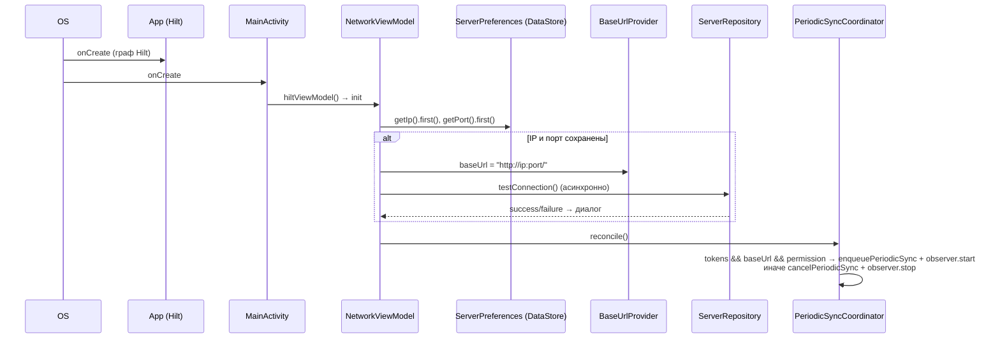
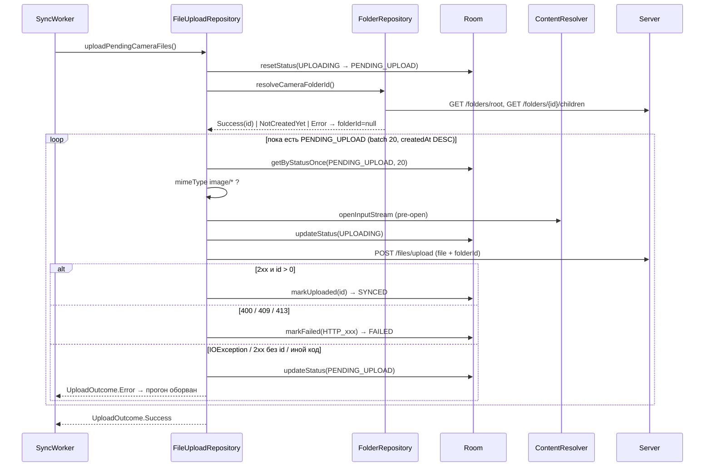
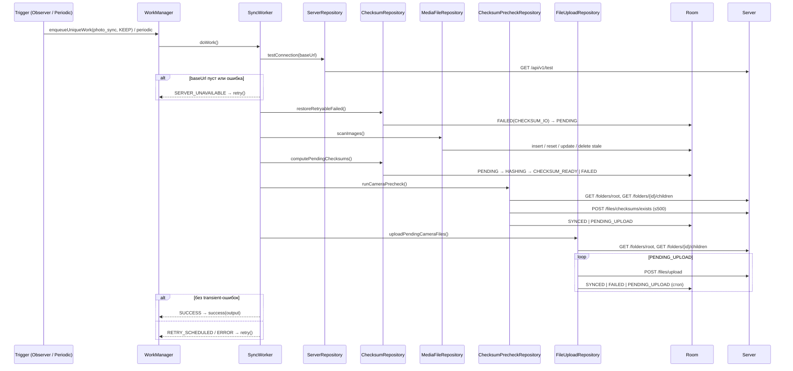

# 08. Business Processes

> Аудит As-Is Android-клиента PhotoCloud. Дата: 2026-09-10, HEAD `2b9ab69`.
> Пути — относительно `app/src/main/java/ru/tbcarus/photo_cloud_client/`. Метки — см. [00-executive-summary.md](00-executive-summary.md).
> Для каждого процесса: Trigger · UI · ViewModel · Repository · DAO · Worker · API · State transitions · Success · Failure. Прочерк означает, что слой не участвует.

---

## P1. Application start

| | |
| --- | --- |
| Trigger | Пользователь открывает приложение (LAUNCHER) |
| UI | `MainActivity.onCreate` → `setContent` → `MainScreen` → `NavHost(start = network)` → `NetworkScreen` |
| ViewModel | `NetworkViewModel` (scope Activity) — `init` (`NetworkViewModel.kt:31-43`) |
| Repository | `ServerPreferences.getIp/getPort().first()`; `ServerRepository.testConnection`; `PeriodicSyncCoordinator.reconcile()` |
| DAO | — |
| Worker | — (WorkManager инициализируется лениво при первом `WorkManager.getInstance`) |
| API | `GET /api/v1/test` (если IP/порт сохранены) |
| State transitions | `BaseUrlProvider.baseUrl` ← `http://ip:port/` (**до** проверки связи, `:36`); periodic + observer включаются или выключаются через `reconcile()` |
| Success | Диалог с сообщением сервера («All good! Permit all connection»). **[CONFIRMED]** Диалог показывается при **каждом** запуске: `testConnection()` пишет `message` в state, и `NetworkScreen` его отображает |
| Failure | Диалог с ошибкой; `baseUrl` при этом **уже установлен** из prefs, sync будет пытаться работать |

**[CONFIRMED]** `App.onCreate` ничего не инициализирует. Восстановление `baseUrl` и первый `reconcile()` происходят только при создании `NetworkViewModel`, то есть только при открытии UI.

## P2. Настройка сервера

| | |
| --- | --- |
| Trigger | Кнопка «Test» на Network |
| UI | `NetworkScreen` (IP, Port, Test) |
| ViewModel | `NetworkViewModel.testConnection()` (`:49-87`) |
| Repository | `ServerRepository.testConnection(baseUrl)`; `ServerPreferences.saveConnection` |
| API | `GET /api/v1/test` (plain, 5 s) |
| State transitions | при успехе: DataStore `ip`/`port`, `baseUrl` |
| Success | зелёный фон, диалог с сообщением сервера |
| Failure | «Введите корректные IP и порт» (невалидный IPv4/пустой порт) или текст ошибки сети/HTTP; `baseUrl` не меняется |

**[CONFIRMED]** `reconcile()` здесь не вызывается. Смена сервера не сбрасывает токены и Room.

## P3. Регистрация

| | |
| --- | --- |
| Trigger | Кнопка «Register» |
| ViewModel / Repository | `AuthViewModel.register()` → `AuthRepository.register()` |
| API | `POST /api/v1/auth/register` (plain) |
| Success | диалог с `message` сервера («Email was sent»); на экран «подтвердите email» не переходит |
| Failure | диалог с `fieldErrors`/`message` (`400`, `409`) |

## P4. Login

См. sequence diagram в [06-auth-security.md](06-auth-security.md) §3.1.

| | |
| --- | --- |
| Trigger | Кнопка «Login» |
| UI | `AuthScreen` → `LoginContent` |
| ViewModel | `AuthViewModel.login()` (`:69-82`) |
| Repository | `AuthRepository.login` → `saveTokens` → `PeriodicSyncCoordinator.reconcile()` |
| API | `POST /api/v1/auth/login` (plain) |
| State transitions | токены в prefs; `isLoggedIn = true`; при наличии разрешения на медиа — periodic enqueued + observer started. **[INFERRED]** Periodic-работа без initial delay выполняется сразу, как только выполнены constraints: это и есть первая синхронизация после входа |
| Success | «Login successful»; экран показывает email из JWT |
| Failure | диалог с сообщением сервера; токены не меняются |

## P5. Scan (Discovery + Room insert/update)

| | |
| --- | --- |
| Trigger | (a) стадия 1 `SyncWorker`; (b) `FilesViewModel.scanPhotos()` — только из callback permission launcher (выдано или отказано) |
| UI | (b): `LoadingDialog` на время scan, результат «Scan result: …» |
| ViewModel | (b) `FilesViewModel.scanPhotos()` (`:50-93`) |
| Repository | `MediaFileRepository.scanImages()` → `MediaStoreRepository.loadImages()` |
| DAO | `insertAll(IGNORE)`, `resetChecksumIfFileChanged` ×N, `updateLocalMetadata` ×N, `getAllMediaStoreIds`, `deleteByMediaStoreIds` (чанки по 500) |
| Worker | `SyncWorker` стадия 1 (`:66-74`) |
| API | — |
| State transitions | новый `_ID` → `PENDING`; изменён `size`/`lastModified` → `PENDING` (любой статус); `_ID` не найден → строка удалена |
| Success | `ScanOutcome.Success(scanned, insertedOrUpdated = scanned, deletedStale)` |
| Failure | `PermissionDenied` → worker `Result.success()` (без записи статуса), UI — карточка; `Error` → worker `ERROR` + `retry()`, UI — текст ошибки |

**[CONFIRMED] Discovery:** полная выборка `DCIM/%` на каждый прогон. Инкрементального сканирования по `DATE_MODIFIED > last` нет; `getLatestCreatedAt()` объявлен, но не используется. **Room insert/update:** без транзакции и без `Mutex` — два scan (UI и worker, или два worker'а) могут выполняться одновременно.

## P6. Checksum calculation

| | |
| --- | --- |
| Trigger | стадия 2 `SyncWorker` |
| Repository | `ChecksumRepository.computePendingChecksums()` (`:64-84`), под `Mutex` |
| DAO | `resetStatus(HASHING→PENDING)`; цикл `getByStatusOnce(PENDING, 100)` → `updateStatus(HASHING)` → `updateChecksum` / `markFailed` |
| API | — |
| State transitions | `PENDING → HASHING → CHECKSUM_READY` или `FAILED(FILE_NOT_FOUND / PERMISSION / CHECKSUM_IO / UNKNOWN)` |
| Success | `ChecksumOutcome.Success(processed, succeeded, failed)`; per-file ошибки прогон не прерывают |
| Failure | разрешения нет → `PermissionDenied` → worker `success()`; исключение уровня прогона (Room) → `Error` → `retry()` |

**[CONFIRMED]** SHA-256 считается потоково, буфер 8 KiB, результат — lowercase hex (`ChecksumUtil.kt:17-25`). Хэшируются **все** найденные файлы до обращения к серверу.

## P7. Server existence check (pre-check)

| | |
| --- | --- |
| Trigger | стадия 3 `SyncWorker` |
| Repository | `ChecksumPrecheckRepository.runCameraPrecheck()` (под `Mutex`) → `FolderRepository.resolveCameraFolderId()` |
| DAO | `getByStatusWithChecksumOnce(CHECKSUM_READY, 500)`; `updateStatusByMediaStoreIds` (чанки по 500) |
| API | `GET /folders/root` → `GET /folders/{rootId}/children` → `POST /files/checksums/exists {folderId, checksums}` (≤ 500) |
| State transitions | `CAMERA` найдена: `existing → SYNCED` (без `serverFileId`), `missing → PENDING_UPLOAD`, прочие остаются `CHECKSUM_READY`. `CAMERA` ещё не создана: **все** `CHECKSUM_READY → PENDING_UPLOAD` без запроса к серверу |
| Success | `ChecksumPrecheckResult(checked, existing, pendingUpload, unchanged)` |
| Failure | ошибка резолва папки или HTTP/исключение pre-check → `Error` → `retry()`; уже обработанные батчи сохраняются |

**[CONFIRMED]** Pre-check выполняется только для папки `CAMERA` (TODO `ChecksumPrecheckRepository.kt:20-22`). Локальные файлы с одинаковым checksum группируются, и один ответ применяется ко всем.

## P8. Upload

| | |
| --- | --- |
| Trigger | стадия 4 `SyncWorker` |
| Repository | `FileUploadRepository.uploadPendingCameraFiles()` (под `Mutex`) |
| DAO | `resetStatus(UPLOADING→PENDING_UPLOAD)`; цикл `getByStatusOnce(PENDING_UPLOAD, 20)`; `updateStatus`, `markUploaded`, `markFailed` |
| API | повторный `GET /folders/root` + `children`; `POST /files/upload` на каждый файл |
| State transitions | см. P9, P10 |

**Алгоритм на один файл [CONFIRMED]** (`FileUploadRepository.kt:76-145`):
1. MIME не `image/*` → `FAILED(NOT_IMAGE)`, следующий файл.
2. Pre-open потока: `FileNotFoundException`/`null` → `FAILED(FILE_NOT_FOUND)`; `SecurityException` → `FAILED(PERMISSION)`; следующий файл.
3. `UPLOADING`.
4. Multipart: `file` (поток `content://`, `filename = displayName`) + `folderId` (если `CAMERA` известна).
5. Синхронный `execute()` → P9 или P10.

## P9. Upload success

| | |
| --- | --- |
| Условие | `2xx` и `body.id > 0` |
| DAO | `markUploaded(mediaStoreId, id)`: `SYNCED`, `serverFileId = id`, retry-поля сброшены |
| Семантика | ответ-дубль (сервер вернул существующую запись) тоже считается успехом (`FileUploadRepository.kt:114`). Имя, папка и checksum из ответа не проверяются и не сохраняются |
| Итог прогона | при отсутствии transient-ошибок `SyncWorker` пишет `SUCCESS` и `Result.success(output)` |

## P10. Upload failure

| Ошибка | Классификация | Статус | Продолжение прогона |
| --- | --- | --- | --- |
| `400` | permanent | `FAILED(HTTP_400)` | следующий файл |
| `409` | permanent | `FAILED(HTTP_409)` | следующий файл |
| `413` | permanent | `FAILED(HTTP_413)` | следующий файл |
| `401` (refresh не помог), `403`, `404`, `5xx`, прочие | transient | `PENDING_UPLOAD` | **прогон оборван** → `UploadOutcome.Error` → `RETRY_SCHEDULED` → `Result.retry()` |
| `2xx` без `id` | transient | `PENDING_UPLOAD` | оборван |
| `IOException` (сеть, таймаут, ошибка чтения тела, несовпадение длины) | transient | `PENDING_UPLOAD` | оборван |
| Иное исключение (например, `SecurityException` из `writeTo`) | не перехвачено | остаётся `UPLOADING` | оборван; `SyncWorker` → `ERROR` → `retry()`; recovery в начале следующей upload-стадии |

**[CONFIRMED]** Transient-ошибка возвращает файл в очередь, и из-за `ORDER BY createdAt DESC` он снова оказывается первым. **[RISK]** Если ошибка воспроизводится на этом файле, более старые файлы не загружаются никогда (см. 16).

## P11. Automatic retry

| Механизм | Триггер | Что повторяется | Лимит |
| --- | --- | --- | --- |
| WorkManager `Result.retry()` | любой `ERROR`/`SERVER_UNAVAILABLE`/`RETRY_SCHEDULED` | весь прогон | **[INFERRED]** неограниченно; backoff по умолчанию — экспоненциальный, 30 с … 5 ч |
| Возврат `CHECKSUM_IO` | шаг 0 `SyncWorker` (`:62-63`), после успешного ping | `FAILED(CHECKSUM_IO) → PENDING` | `retryCount < 3`, `lastFailureAt ≤ now − 5 мин`, ≤ 500 строк за прогон |
| Recovery `HASHING`/`UPLOADING` | начало соответствующей стадии | зависшие записи | нет |
| Transient upload | следующий прогон | `PENDING_UPLOAD` | нет |
| `ContentObserver` / periodic | новое событие / раз в час | весь прогон | `KEEP`: пока `photo_sync` в ENQUEUED/RUNNING, новые запросы игнорируются |

## P12. Manual retry

**[CONFIRMED] NOT FOUND.** Кнопок повтора, «Sync now», сброса `FAILED` нет (удалены в Stage 5J.2). Косвенные способы повлиять на sync:
- изменить файл (сброс в `PENDING`);
- сделать новое фото (сработает observer);
- выдать разрешение — это запускает только UI-scan, не pipeline;
- перезайти (`reconcile()` → `enqueuePeriodicSync(UPDATE)`).

## P13. App restart (гибель процесса и повторный запуск)

| Этап | Поведение |
| --- | --- |
| Процесс убит во время hashing | строка остаётся `HASHING` → при следующем checksum → `PENDING` |
| Процесс убит во время upload | строка остаётся `UPLOADING` → при следующем upload → `PENDING_UPLOAD` → повторная загрузка; если сервер уже сохранил файл, вернётся существующий `id` (идемпотентность) |
| Незавершённая работа WorkManager | **[INFERRED]** переназначается библиотекой |
| Запуск без UI (worker поднял процесс) | **[CONFIRMED]** `BaseUrlProvider.baseUrl == ""` → `SERVER_UNAVAILABLE` → `retry()`; observer не зарегистрирован |
| Пользователь открыл UI | P1: `baseUrl` восстановлен, `reconcile()` → observer зарегистрирован, periodic `UPDATE` |
| `SyncStatusStore` | пуст — карточка итога не отображается до следующего прогона |

## P14. Device restart

**[INFERRED — поведение WorkManager]** Периодическая и незавершённая one-time работа переназначаются после загрузки через внутренние ресиверы WorkManager. Своего `BOOT_COMPLETED` у приложения нет.

**[CONFIRMED]** Worker запускается в процессе без UI → пустой `baseUrl` → `SERVER_UNAVAILABLE` → `retry()` с растущим backoff. `MediaChangeObserver` не регистрируется. **Итог: после перезагрузки ни одно фото не загрузится, пока пользователь не откроет приложение.**

## P15. Media permission loss

| Этап | Поведение |
| --- | --- |
| Пользователь отзывает разрешение в настройках | **[INFERRED]** Android завершает процесс приложения |
| Worker без разрешения | ping → restore `CHECKSUM_IO` → scan `PermissionDenied` → `Result.success()`; Room не меняется, статус не записывается |
| Если отказ пришёлся на середину hashing/upload | `SecurityException` → `FAILED(PERMISSION)` — **терминально**, после повторной выдачи разрешения не восстанавливается |
| Открытие UI | P1 → `reconcile()`: разрешения нет → periodic отменена, observer остановлен. Вкладка Files → повторный запрос разрешения |
| Уже поставленная one-time работа | не отменяется; выполнится вхолостую |

## P16. Local file modification

| | |
| --- | --- |
| Trigger | изменение файла → событие `ContentObserver` (если активен) или periodic |
| Repository / DAO | scan → `resetChecksumIfFileChanged` |
| State transitions | любой статус → `PENDING`, `checksum = NULL`, `serverFileId = NULL`, retry-поля сброшены → hashing → pre-check → (новые байты) `PENDING_UPLOAD` → upload |
| Результат на сервере | **[INFERRED]** новый `FileItem`; прежняя серверная запись остаётся (overwrite нет), связь с ней потеряна |
| Особенности | изменение файла во время upload — гонка (см. 09 §5) |

## P17. Local file deletion

| | |
| --- | --- |
| Trigger | удаление → событие observer / periodic |
| Repository / DAO | scan → stale detection → `deleteByMediaStoreIds` |
| State transitions | строка удаляется из любого статуса; `LOCAL_DELETED` не используется |
| API | — (сервер не уведомляется) |
| Результат | серверная копия остаётся (фактическая backup-модель); на устройстве нет следа, что файл когда-то был синхронизирован |
| Удаление между scan и upload | pre-open → `FAILED(FILE_NOT_FOUND)`; строка удалится следующим scan |

## P18. Logout

См. sequence diagram в [06-auth-security.md](06-auth-security.md) §3.3.

| | |
| --- | --- |
| Trigger | кнопка «Logout» |
| ViewModel | `AuthViewModel.logout()` → `reconcile()` |
| Repository | `AuthRepository.logout()` |
| API | `POST /auth/logout` (auth; при `401` — refresh и повтор) |
| State transitions | токены очищены (кроме `IOException`); periodic отменена; observer остановлен |
| Не затрагивается | Room, one-time `photo_sync` (в том числе ожидающая retry), `SyncStatusStore`, адрес сервера |
| Следствие | **[INFERRED]** ожидающая retry one-time работа продолжит выполнять scan + hashing и получать `401` на pre-check, ретраясь с backoff; строки `SYNCED` предыдущего аккаунта сохраняются и при входе другим пользователем не будут загружены |

---

## Фактический sync protocol (восстановлен по коду)

1. **Обнаружение media.** Полный запрос MediaStore Images с фильтром `RELATIVE_PATH LIKE 'DCIM/%'`. Выполняется в каждом прогоне `SyncWorker` (стадия 1) и однократно после выдачи разрешения. Триггеры прогона: `ContentObserver` (debounce 3 с, unique `photo_sync`, `KEEP`) и periodic (1 ч, `photo_sync_periodic`). Перед всем — `GET /api/v1/test`.
2. **Сохранение локального состояния.** `insertAll(IGNORE)` новых `_ID` как `PENDING`; перезапись LOCAL-метаданных; сброс в `PENDING` при изменении `size`/`DATE_MODIFIED`; удаление строк, чей `_ID` исчез.
3. **Вычисление checksum.** Стадия 2, до любого обращения к API файлов: SHA-256 всех `PENDING` (батчи по 100) → `CHECKSUM_READY`. Перед этим возвращаются `FAILED(CHECKSUM_IO)` с истёкшим cooldown.
4. **Обращение к серверу.** Стадия 3: `GET /folders/root` → `GET /folders/{root}/children` → поиск `folderType == "CAMERA"`.
5. **Нужен ли upload.** Если `CAMERA` нет — нужен всем. Иначе `POST /files/checksums/exists {folderId: CAMERA, checksums ≤ 500}`: `existing` → `SYNCED` (без `serverFileId`), `missing` → `PENDING_UPLOAD`.
6. **Выполнение upload.** Стадия 4: повторный резолв `CAMERA`; для каждого `PENDING_UPLOAD` (батчи по 20, от новых к старым) — guard MIME, pre-open, `UPLOADING`, `POST /files/upload` (`file` + `folderId`, если известен).
7. **Фиксация успеха.** `2xx` с `id > 0` → `SYNCED` + `serverFileId`. Прогон без transient-ошибок → `SyncStatus.SUCCESS`, `Result.success()`.
8. **Фиксация ошибки.** `400/409/413`, `NOT_IMAGE`, `FILE_NOT_FOUND`, `PERMISSION` → `FAILED(reason)`, `retryCount++`. Transient → `PENDING_UPLOAD`, прогон оборван, `RETRY_SCHEDULED`.
9. **Retry.** `Result.retry()` — повтор всего прогона с backoff WorkManager; `CHECKSUM_IO` — до 3 раз с cooldown 5 мин; прочие `FAILED` не повторяются.
10. **Продолжение после restart.** Всё состояние в Room; `HASHING`/`UPLOADING` сбрасываются в начале своих стадий; повторная загрузка безопасна благодаря серверной идемпотентности. Без открытия UI `baseUrl` пуст, и продолжения нет.

Сравнение с `05-sync-upload-contract.md` — в [19-server-client-consistency.md](19-server-client-consistency.md) §8.

