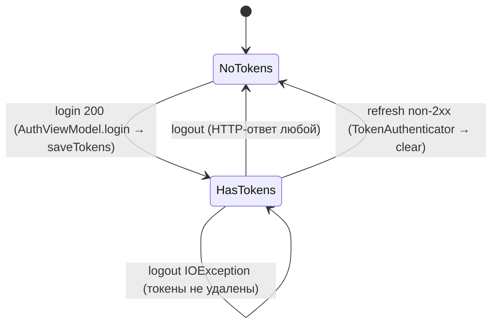

# 09. State Machines

> Аудит As-Is Android-клиента PhotoCloud. Дата: 2026-09-10, HEAD `2b9ab69`.
> Пути — относительно `app/src/main/java/ru/tbcarus/photo_cloud_client/`. Метки — см. [00-executive-summary.md](00-executive-summary.md).

---

## 1. Элементы состояния `MediaFile`

| Элемент | Значения | Файл |
| --- | --- | --- |
| `status: MediaFileStatus` | `PENDING`, `HASHING`, `CHECKSUM_READY`, `PENDING_UPLOAD`, `UPLOADING`, `SYNCED`, `FAILED`, `LOCAL_DELETED` (**[UNUSED]**) | `media/MediaFileStatus.kt` |
| `failureReason: FailureReason?` | `CHECKSUM_IO`, `FILE_NOT_FOUND`, `PERMISSION`, `NOT_IMAGE`, `HTTP_400`, `HTTP_409`, `HTTP_413`, `UNKNOWN` | `media/FailureReason.kt` |
| Флаги-производные | `checksum != null`, `serverFileId != null` | `media/MediaFile.kt` |
| Retry counters | `retryCount: Int` | — |
| Timestamps | `lastFailureAt: Long?` (ms), `createdAt`, `lastModified` (LOCAL, в state machine участвуют только как детектор изменений) | — |

Фактически в коде есть **две фазы** — «checksum» (`PENDING → HASHING → CHECKSUM_READY`) и «sync» (`CHECKSUM_READY → PENDING_UPLOAD → UPLOADING → SYNCED`) — плюс общее состояние `FAILED`. Аналог «DISCOVERED» — `PENDING`, «READY» — `CHECKSUM_READY` / `PENDING_UPLOAD`, «UPLOADED» — `SYNCED`.

## 2. Таблица переходов

| # | Current state | Event | Condition | New state | Побочные изменения | Code location |
| --- | --- | --- | --- | --- | --- | --- |
| T1 | — (нет строки) | scan нашёл `_ID` | PK отсутствует в Room | `PENDING` | все поля из MediaStore, `checksum=null` | `MediaFileRepository.kt:38, 88-100`; `MediaFileDao.insertAll` |
| T2 | **любой** | scan | `size` или `lastModified` ≠ сохранённым | `PENDING` | `checksum=null`, `serverFileId=null`, `failureReason=null`, `retryCount=0`, `lastFailureAt=null` | `MediaFileRepository.kt:47-51`; `MediaFileDao.kt:155-171` |
| T3 | **любой** | scan | `_ID` отсутствует в выборке `DCIM/%` | (строка удалена) | — | `MediaFileRepository.kt:65-74` |
| T4 | `HASHING` | старт checksum-стадии | всегда (recovery) | `PENDING` | — | `ChecksumRepository.kt:88-91` |
| T5 | `PENDING` | checksum-стадия взяла батч | разрешение есть | `HASHING` | — | `ChecksumRepository.kt:98-102` |
| T6 | `HASHING` | SHA-256 посчитан | — | `CHECKSUM_READY` | `checksum=sha256`, failure-поля и `retryCount` сброшены | `ChecksumRepository.kt:114-115`; `MediaFileDao.kt:30-43` |
| T7 | `HASHING` | `openInputStream == null` | — | `FAILED` | `reason=FILE_NOT_FOUND`, `retryCount+1`, `lastFailureAt=now` | `ChecksumRepository.kt:107-112` |
| T8 | `HASHING` | `SecurityException` | — | `FAILED` | `reason=PERMISSION` | `ChecksumRepository.kt:118-122` |
| T9 | `HASHING` | `FileNotFoundException` | — | `FAILED` | `reason=FILE_NOT_FOUND` | `ChecksumRepository.kt:123-126` |
| T10 | `HASHING` | `IOException` | — | `FAILED` | `reason=CHECKSUM_IO` | `ChecksumRepository.kt:127-131` |
| T11 | `HASHING` | прочий `Exception` | — | `FAILED` | `reason=UNKNOWN` | `ChecksumRepository.kt:132-136` |
| T12 | `FAILED` | шаг 0 `SyncWorker` | `reason=CHECKSUM_IO` ∧ `retryCount<3` ∧ `lastFailureAt ≤ now−5 мин`; ping сервера успешен | `PENDING` | `failureReason=null`, `lastFailureAt=null`, **`retryCount` сохраняется** | `ChecksumRepository.kt:45-57`; `MediaFileDao.kt:83-90`; `SyncWorker.kt:62` |
| T13 | `CHECKSUM_READY` | pre-check | `CAMERA` ещё не создана | `PENDING_UPLOAD` | — | `ChecksumPrecheckRepository.kt:43, 53-75` |
| T14 | `CHECKSUM_READY` | pre-check | checksum ∈ `existing` | `SYNCED` | `serverFileId` **остаётся null** | `ChecksumPrecheckRepository.kt:116, 123-125` |
| T15 | `CHECKSUM_READY` | pre-check | checksum ∈ `missing` | `PENDING_UPLOAD` | — | `ChecksumPrecheckRepository.kt:117, 126-128` |
| T16 | `CHECKSUM_READY` | pre-check | checksum нет ни в одном списке | `CHECKSUM_READY` | — | `ChecksumPrecheckRepository.kt:118` |
| T17 | `UPLOADING` | старт upload-стадии | всегда (recovery) | `PENDING_UPLOAD` | — | `FileUploadRepository.kt:53-56` |
| T18 | `PENDING_UPLOAD` | upload-стадия | `!mimeType.startsWith("image/")` | `FAILED` | `reason=NOT_IMAGE` | `FileUploadRepository.kt:80-84` |
| T19 | `PENDING_UPLOAD` | pre-open | `null`-поток / `FileNotFoundException` | `FAILED` | `reason=FILE_NOT_FOUND` | `FileUploadRepository.kt:88-93, 155-159` |
| T20 | `PENDING_UPLOAD` | pre-open | `SecurityException` | `FAILED` | `reason=PERMISSION` | `FileUploadRepository.kt:160-161` |
| T21 | `PENDING_UPLOAD` | pre-open успешен | — | `UPLOADING` | — | `FileUploadRepository.kt:95` |
| T22 | `UPLOADING` | ответ `2xx` | `id != null && id > 0` | `SYNCED` | `serverFileId=id`, failure-поля и `retryCount` сброшены | `FileUploadRepository.kt:111-116`; `MediaFileDao.kt:115-124` |
| T23 | `UPLOADING` | ответ `2xx` | `id` пуст или ≤ 0 | `PENDING_UPLOAD` | прогон оборван | `FileUploadRepository.kt:117-125` |
| T24 | `UPLOADING` | ответ `400`/`409`/`413` | — | `FAILED` | `reason=HTTP_4xx` | `FileUploadRepository.kt:129-133, 177-182` |
| T25 | `UPLOADING` | прочий HTTP-код (`401`, `403`, `404`, `5xx`…) | — | `PENDING_UPLOAD` | прогон оборван | `FileUploadRepository.kt:134-143` |
| T26 | `UPLOADING` | `IOException` | — | `PENDING_UPLOAD` | прогон оборван | `FileUploadRepository.kt:100-109` |
| T27 | `UPLOADING` | не-`IOException` из `execute()`/`writeTo()` | — | `UPLOADING` (без изменений) | исключение → `SyncWorker` → `retry()`; далее T17 | `FileUploadRepository.kt:98-109`; `SyncWorker.kt:38-44` |
| T28 | `PENDING_UPLOAD` | pre-open бросил иное исключение | — | `PENDING_UPLOAD` | прогон оборван исключением | `FileUploadRepository.kt:155-162` |
| — | `SYNCED` | — | — | терминальное (выход только по T2/T3) | — | — |
| — | `FAILED` (кроме T12) | — | — | терминальное (выход только по T2/T3) | — | — |
| — | `LOCAL_DELETED` | — | — | недостижимо | — | `MediaFileStatus.kt:13` |

## 3. Диаграмма состояний

```mermaid
stateDiagram-v2
    [*] --> PENDING: T1 scan нашёл новый _ID
    PENDING --> HASHING: T5 checksum-стадия
    HASHING --> PENDING: T4 recovery в начале стадии
    HASHING --> CHECKSUM_READY: T6 SHA-256 готов
    HASHING --> FAILED: T7-T11 FILE_NOT_FOUND / PERMISSION / CHECKSUM_IO / UNKNOWN
    FAILED --> PENDING: T12 auto-retry, только CHECKSUM_IO, до 3 раз, cooldown 5 мин
    CHECKSUM_READY --> SYNCED: T14 pre-check existing (serverFileId = null)
    CHECKSUM_READY --> PENDING_UPLOAD: T13 CAMERA нет / T15 missing
    CHECKSUM_READY --> CHECKSUM_READY: T16 нет в ответе
    PENDING_UPLOAD --> FAILED: T18-T20 NOT_IMAGE / FILE_NOT_FOUND / PERMISSION
    PENDING_UPLOAD --> UPLOADING: T21
    UPLOADING --> SYNCED: T22 2xx + id
    UPLOADING --> FAILED: T24 HTTP 400 / 409 / 413
    UPLOADING --> PENDING_UPLOAD: T17 recovery / T23 / T25 / T26 transient
    SYNCED --> PENDING: T2 файл изменён
    FAILED --> PENDING: T2 файл изменён
    CHECKSUM_READY --> PENDING: T2
    PENDING_UPLOAD --> PENDING: T2
    UPLOADING --> PENDING: T2 (гонка)
    SYNCED --> [*]: T3 файл исчез из MediaStore
    FAILED --> [*]: T3
    PENDING --> [*]: T3
    state LOCAL_DELETED
    note right of LOCAL_DELETED: объявлен, недостижим
```

## 4. Недопустимые и противоречивые состояния

| Комбинация | Достижима? | Как | Метка |
| --- | --- | --- | --- |
| `SYNCED` ∧ `serverFileId = null` | **да, штатно** | T14 (pre-check), а также после T2 → повторный pipeline | **[CONFIRMED]** состояние неоднозначно: «загружено этим клиентом» и «уже было на сервере» не различаются |
| `FAILED` ∧ `failureReason = null` | **да** | строки, бывшие `FAILED` до миграции `2→3` (Stage 5K) | **[CONFIRMED]** такие строки никогда не авто-повторяются; UI показывает «Failed» без причины |
| `failureReason ≠ null` ∧ `status ≠ FAILED` | нет | все переходы из `FAILED` обнуляют `failureReason` | **[CONFIRMED]** инвариант соблюдается |
| `status = PENDING` ∧ `checksum ≠ null` | нет | все пути в `PENDING` обнуляют checksum или идут из состояний с `null` | **[CONFIRMED]** |
| `status ∈ {PENDING_UPLOAD, UPLOADING, SYNCED}` ∧ `checksum = null` | **да, при гонке** | pre-check прочитал `CHECKSUM_READY` → параллельный scan сделал T2 (`PENDING`, `checksum=null`) → pre-check `updateStatusByMediaStoreIds` без проверки статуса перевёл строку в `PENDING_UPLOAD` → upload → `SYNCED` с `checksum=null` | **[INFERRED]** возможно, так как scan не под `Mutex`, а UPDATE не проверяют текущий статус |
| `CHECKSUM_READY` ∧ checksum не соответствует содержимому | **да, при гонке** | hashing идёт → scan делает T2 → hashing завершает `updateChecksum` (старый хэш, `CHECKSUM_READY`); следующий scan изменений не видит | **[INFERRED]** |
| `retryCount > 0` ∧ `status ∈ {PENDING, HASHING}` | да, штатно | после T12 | **[CONFIRMED]** |
| `HASHING`/`UPLOADING` без активного worker'а | да | гибель процесса; стоп worker'а; прогон, завершившийся до нужной стадии (сервер недоступен, нет разрешения) | **[CONFIRMED]** UI-счётчики «Hashing»/«Uploading» могут долго показывать неактивные записи |
| `SYNCED` с `serverFileId` записи из **другой** папки | возможно | резолв `CAMERA` в upload упал → upload без `folderId` → сервер положил файл по MIME в `Files` | **[INFERRED]** |
| `SYNCED`, но файла на сервере нет | возможно | удалён с сервера другим клиентом или вручную; обратной сверки нет | **[INFERRED]** |
| `SYNCED` от другого аккаунта или сервера | возможно | logout/login другим пользователем или смена IP без очистки Room | **[CONFIRMED]** |

## 5. Конкурентность и гонки

**[CONFIRMED]** Защита:
- `Mutex` в `ChecksumRepository`, `ChecksumPrecheckRepository`, `FileUploadRepository` — внутри процесса;
- `KEEP` для one-time работы.

**Не защищены:**

| Участок | Кто может пересечься |
| --- | --- |
| `MediaFileRepository.scanImages()` | UI-scan (`FilesViewModel`) ↔ scan worker'а; one-time ↔ periodic worker (разные unique-имена, выполняются параллельно) |
| `restoreRetryableFailed()` | два worker'а одновременно (результат идемпотентен) |
| UPDATE без проверки текущего статуса | scan-сброс T2 ↔ любая стадия |

**[INFERRED]** Одновременный запуск one-time и periodic: стадии сериализуются мьютексами. Второй worker, дождавшись мьютекса, выполнит recovery (`HASHING→PENDING`, `UPLOADING→PENDING_UPLOAD`) уже **после** завершения первого, так что активные записи не сбрасываются.

## 6. Восстановление после process death

| Состояние в момент смерти | Восстановление | Когда |
| --- | --- | --- |
| `HASHING` | T4 → `PENDING` → перехэширование | начало следующей checksum-стадии |
| `UPLOADING` (сервер не получил файл) | T17 → `PENDING_UPLOAD` → повтор | начало следующей upload-стадии |
| `UPLOADING` (сервер сохранил, ответ не записан) | T17 → повтор → сервер вернёт существующий `id` → T22 | то же |
| Частично применённый scan | следующий scan идемпотентно доводит | следующий прогон |
| Частично применённый pre-check | обработанные батчи сохранены, остальные `CHECKSUM_READY` | следующий прогон |
| `SyncStatusStore` | утерян | — |

**[CONFIRMED]** Все переходы восстановления требуют, чтобы следующий прогон дошёл до нужной стадии. В процессе без UI он до неё не доходит (пустой `baseUrl` → ping не выполняется).

## 7. Восстановление после WorkManager interruption

**[INFERRED — поведение WorkManager/корутин]** При остановке worker'а (потеря constraint, лимит времени исполнения, отмена):
- корутина отменяется, но блокирующие `execute()` и `ChecksumUtil.sha256` доработают до конца;
- `CancellationException` вылетит на ближайшем suspend-вызове DAO;
- записи останутся `HASHING`/`UPLOADING` и будут восстановлены по §6.

**[CONFIRMED]** `doWork()` ловит `Exception` (включая `CancellationException`), пишет `SyncStatus.ERROR` и возвращает `Result.retry()` (`SyncWorker.kt:38-44`). **[INFERRED]** Для остановленного worker'а WorkManager этот результат игнорирует и переназначает работу сам. В UI отображается «Ошибка синхронизации», хотя ошибки не было.

## 8. Вспомогательные state machines

### 8.1. Сессия (auth)



### 8.2. Автосинхронизация (результат `reconcile()`)

| Условие (`tokens ∧ baseUrl ∧ permission`) | periodic `photo_sync_periodic` | `MediaChangeObserver` |
| --- | --- | --- |
| true | `enqueueUniquePeriodicWork(UPDATE)` | `start()` |
| false | `cancelUniqueWork` | `stop()` |

Вызовы `reconcile()`: `NetworkViewModel.init`, `AuthViewModel.login` (успех), `AuthViewModel.logout`, `FilesViewModel.ensureAutoSyncStarted` / `onMediaPermissionGranted`. **[CONFIRMED]** Очистка токенов в `TokenAuthenticator` `reconcile()` не вызывает.

### 8.3. Итог прогона (`SyncStatus`, в памяти)

| Путь `SyncWorker` | Записанный статус | Result |
| --- | --- | --- |
| `baseUrl` пуст / ping failed | `SERVER_UNAVAILABLE` | `retry` |
| scan `Error`, checksum `Error`, pre-check `Error`, исключение | `ERROR` | `retry` |
| scan/checksum `PermissionDenied` | **не записывается** | `success` |
| upload `Error` | `RETRY_SCHEDULED` | `retry` |
| upload `Success` (`leftPending` всегда 0) | `SUCCESS` | `success(output)` |
