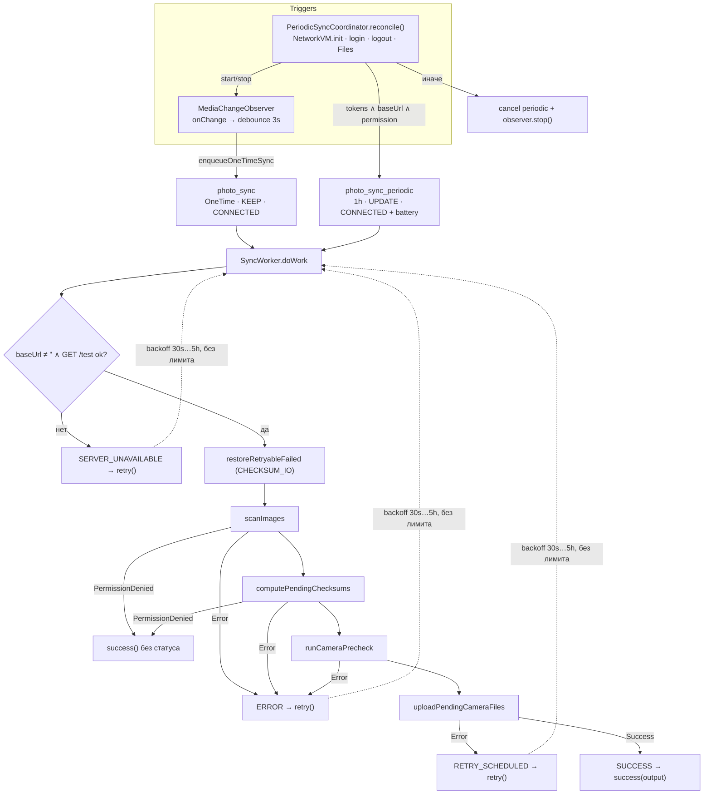

# 12. Background Jobs

> Аудит As-Is Android-клиента PhotoCloud. Дата: 2026-09-10, HEAD `2b9ab69`.
> Пути — относительно `app/src/main/java/ru/tbcarus/photo_cloud_client/`. Метки — см. [00-executive-summary.md](00-executive-summary.md).
> Поведение WorkManager/Android, не выраженное в коде проекта, помечено **[INFERRED]** как поведение библиотеки/платформы.

---

## 1. Компоненты фонового контура

| Компонент | Тип | Файл | Роль |
| --- | --- | --- | --- |
| `SyncWorker` | `@HiltWorker CoroutineWorker` | `media/SyncWorker.kt` | единственный worker; весь pipeline |
| `SyncScheduler` | `@Singleton` | `media/SyncScheduler.kt` | enqueue/cancel, наблюдение `WorkInfo` |
| `PeriodicSyncCoordinator` | `@Singleton` | `media/PeriodicSyncCoordinator.kt` | правило включения periodic + observer |
| `MediaChangeObserver` | `@Singleton` + `ContentObserver` | `media/MediaChangeObserver.kt` | событийный триггер one-time sync |
| `SyncStatusStore` | `@Singleton` | `media/SyncStatusStore.kt` | итог последнего прогона (в памяти) |
| `App` | `Application`, `Configuration.Provider` | `App.kt` | `HiltWorkerFactory` для WorkManager |

**[CONFIRMED]** Других фоновых механизмов нет: foreground service, `AlarmManager`, `BroadcastReceiver`, `JobService`, expedited work, уведомления отсутствуют.

## 2. `SyncWorker`

| Атрибут | One-time | Periodic |
| --- | --- | --- |
| Класс | `SyncWorker` | тот же `SyncWorker` |
| Unique name | `photo_sync` (`SyncScheduler.kt:30`) | `photo_sync_periodic` (`:31`) |
| Trigger | `MediaChangeObserver.onMediaChanged()` → debounce 3 с → `enqueueOneTimeSync()` (`MediaChangeObserver.kt:67-74`). **Других вызовов нет** | `PeriodicSyncCoordinator.reconcile()` → `enqueuePeriodicSync()` |
| Input data | нет | нет |
| Output data | только при `Result.success(buildOutput)`: `scan_scanned`, `checksum_processed`, `precheck_checked`, `upload_attempted`, `upload_succeeded`, `upload_failed`, `upload_left_pending` (`SyncWorker.kt:123-131`). При `PermissionDenied` — `success()` без данных | то же |
| Constraints | `NetworkType.CONNECTED` | `CONNECTED` + `setRequiresBatteryNotLow(true)` |
| Uniqueness policy | `ExistingWorkPolicy.KEEP` — при существующей незавершённой работе новый запрос отбрасывается | `ExistingPeriodicWorkPolicy.UPDATE` |
| Интервал | — | 1 ч, flex не задан |
| Retry | `Result.retry()` на всех ошибочных путях | то же |
| Backoff | не настроен → **[INFERRED]** экспоненциальный, 30 с, потолок 5 ч | то же |
| Лимит попыток | **нет** (`runAttemptCount` не используется) | нет |
| Chaining | нет; стадии выполняются внутри одного `doWork()` | нет |
| Persisted state | Room `media_files`; очередь WorkManager; `SyncStatusStore` — только память | то же |
| Dispatcher | `CoroutineWorker` по умолчанию; репозитории переключаются на `Dispatchers.IO` | то же |

### 2.1. Pipeline внутри `doWork()`

| # | Стадия | Вызов | Исход → `Result` | Статус в `SyncStatusStore` |
| --- | --- | --- | --- | --- |
| 0a | Проверка сервера | `baseUrl.isBlank() \|\| serverRepository.testConnection(baseUrl).isFailure` (`:50-55`) | fail → `retry()` | `SERVER_UNAVAILABLE` |
| 0b | Auto-retry `CHECKSUM_IO` | `checksumRepository.restoreRetryableFailed()` (`:62-63`) | исключение → внешний catch → `retry()` | `ERROR` |
| 1 | Scan | `mediaFileRepository.scanImages()` (`:66-74`) | `PermissionDenied` → `success()`; `Error` → `retry()` | — / `ERROR` |
| 2 | Checksum | `checksumRepository.computePendingChecksums()` (`:77-84`) | `PermissionDenied` → `success()`; `Error` → `retry()` | — / `ERROR` |
| 3 | Pre-check | `checksumPrecheckRepository.runCameraPrecheck()` (`:87-93`) | `Error` → `retry()` | `ERROR` |
| 4 | Upload | `fileUploadRepository.uploadPendingCameraFiles()` (`:98-110`) | `Error` → `retry()`; `Success` → `success(output)` | `RETRY_SCHEDULED` / `SUCCESS` |
| — | Любое исключение | `catch (Exception)` (`:38-44`) | `retry()` | `ERROR` |

**[CONFIRMED]** Ветка `retryNeeded = outcome.result.leftPending > 0` для `UploadOutcome.Success` (`:103`) всегда даёт `false`: `leftPending` увеличивается только перед `return UploadOutcome.Error`.

**[CONFIRMED]** Стадии 0b–2 полностью локальные, но выполняются только после успешного ping сервера. При недоступном сервере новые фото даже не индексируются и не хэшируются.

### 2.2. Нагрузка одного прогона

**[CONFIRMED]** Каждый прогон, дошедший до upload, делает минимум 5 HTTP-запросов, даже если синхронизировать нечего:
- `GET /test`;
- 2 × `GET /folders/root`;
- 2 × `GET /folders/{id}/children`.

К ним добавляется полный запрос MediaStore и N пар `UPDATE` в Room.

## 3. Триггеры и их жизненный цикл

### 3.1. `PeriodicSyncCoordinator.reconcile()`

**Правило** (`PeriodicSyncCoordinator.kt:38-50`): `tokens != null && baseUrl != "" && media permission granted` → `enqueuePeriodicSync()` + `observer.start()`; иначе `cancelPeriodicSync()` + `observer.stop()`.

| Кто вызывает | Когда |
| --- | --- |
| `NetworkViewModel.init` | каждое создание Activity-scoped VM (запуск UI) |
| `AuthViewModel.login` | после успешного входа |
| `AuthViewModel.logout` | после любого исхода logout |
| `FilesViewModel.ensureAutoSyncStarted` | вход на Files при уже выданном разрешении |
| `FilesViewModel.onMediaPermissionGranted` | выдача разрешения |
| `TokenAuthenticator` (очистка токенов) | **не вызывает** |
| Worker / `App.onCreate` | **не вызывают** |

### 3.2. `MediaChangeObserver`

- `start()`/`stop()` идемпотентны (флаг `registered`, `:40, 48-65`).
- `Handler(Looper.getMainLooper())`.
- Debounce через `CoroutineScope(SupervisorJob() + Dispatchers.Default)`; scope никогда не отменяется, что допустимо для singleton.
- `onChange` не фильтрует URI: изменения вне `DCIM/` и удаления тоже запускают sync.
- **[CONFIRMED]** Регистрация живёт только в памяти процесса.
- **[INFERRED — платформа]** В кэшированном или замороженном фоновом процессе (Android 11+ cached apps freezer) доставка `onChange` откладывается. После гибели процесса observer отсутствует до следующего `reconcile()`, то есть до открытия UI.

## 4. Сценарии

| Сценарий | Поведение |
| --- | --- |
| **Interruption** (constraint потерян, лимит времени, отмена) | **[INFERRED]** Корутина отменяется; блокирующие `execute()`/hashing доработают; `CancellationException` на ближайшем DAO-вызове. **[CONFIRMED]** `catch (Exception)` записывает `ERROR` и возвращает `retry()`. **[INFERRED]** WorkManager переназначает работу сам. Записи `HASHING`/`UPLOADING` восстанавливаются на следующем прогоне |
| **Duplicate workers** | One-time: `KEEP` — второго экземпляра `photo_sync` не будет. Periodic: одна. **[CONFIRMED]** One-time и periodic — разные unique-имена и могут выполняться **одновременно**; стадии checksum/pre-check/upload сериализуются `Mutex`, scan — нет |
| **App restart** | **[CONFIRMED]** Worker в новом процессе видит `baseUrl == ""` → `SERVER_UNAVAILABLE` → `retry()`, пока UI не восстановит `baseUrl`. После открытия UI и следующей попытки pipeline продолжается с состояния Room |
| **Reboot** | **[INFERRED]** WorkManager переназначает работы собственными ресиверами. Дальше как «app restart»: без открытия UI прогоны уходят в `SERVER_UNAVAILABLE`; observer не зарегистрирован |
| **Network loss** | До старта: constraint `CONNECTED` задерживает запуск. Во время прогона: **[INFERRED]** WorkManager останавливает worker при потере constraint; если остановка не пришла, `IOException` в upload → transient → `retry()`; pre-check/folder → `Error` → `retry()` |
| **Worker retry** | Повторяется весь pipeline с начала: ping, restore, **полный** scan, hashing новых, pre-check, upload. Прогресс сохранён в Room, повторной работы по завершённым файлам нет (кроме head-of-line, см. 16 I1) |
| **Retry + новое фото** | **[CONFIRMED]** `KEEP`: пока `photo_sync` в `ENQUEUED` (ждёт backoff) или `RUNNING`, новые события observer отбрасываются. **[INFERRED]** Новое фото может ждать до конца backoff (до 5 ч) или periodic |
| **Logout** | periodic отменена, observer остановлен; **one-time `photo_sync` не отменяется**. **[INFERRED]** Если она ждёт retry, то продолжит прогоны: scan и hashing выполняются, pre-check получает `401` (запросы без токена) → `retry()` |
| **Токены очищены authenticator'ом** | `reconcile()` не вызывается: periodic и observer продолжают запускать pipeline, получающий `401` |
| **Media permission revoked** | прогоны завершаются `success()` на scan; periodic отменяется только при следующем `reconcile()` |
| **Battery low** | periodic откладывается; one-time — нет |
| **Долгий начальный sync** | **[INFERRED]** Без foreground-режима worker ограничен окном исполнения JobScheduler (порядка 10 мин). После остановки прогон продолжится со следующей попытки, прогресс по файлам сохранён |
| **Doze / App Standby** | **[INFERRED]** Отложенный запуск по правилам платформы; foreground-исполнения нет |

## 5. Наблюдение из UI

| Что | Как | Ограничение |
| --- | --- | --- |
| «Идёт синхронизация» | `getWorkInfosForUniqueWorkFlow("photo_sync")` → `any { RUNNING }` (`SyncScheduler.kt:87-92`) | periodic-прогоны не отображаются; `ENQUEUED`/`BLOCKED` намеренно не считаются |
| Итог | `SyncStatusStore.observe()` | только в памяти; после перезапуска `null`; `PermissionDenied`-пути не пишут статус |
| Счётчики | `Flow` всей таблицы Room | отражают фактическое состояние файлов |

## 6. Диаграмма

