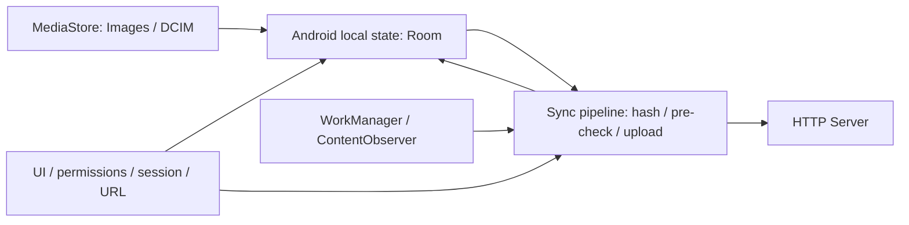

# Граница Android-клиента

Android отвечает за выбор локальных изображений, чтение их потоков, индекс и очередь Room, хранение пары токенов и адреса сервера, постановку WorkManager requests и взаимодействие с пользователем.

| Граница | Ответственность Android | Внешняя сторона |
| --- | --- | --- |
| MediaStore | Query Images/DCIM, metadata normalization, построение content URI, чтение потока | ОС определяет видимость, содержимое потока, permissions и события |
| Room | Локальные metadata, checksum, статусы и причины ошибок | Не является копией серверной БД |
| Сессия | Login/refresh/logout requests, encrypted pair, Bearer | Сервер определяет валидность токенов и principal |
| Server URL | IPv4/port в DataStore; in-memory BaseUrlProvider | Доступность сети и server deployment вне клиента |
| Background | Constraints, unique work, observer/debounce, порядок стадий | ОС/WorkManager определяют фактическое время запуска и остановку |
| HTTP | Десять операций, JSON/multipart и клиентская обработка результатов | Серверный контракт закреплён в frozen пакете |
| UI | Network/Auth/Files, permissions, сообщения, две заглушки | Пользователь вводит сервер и credentials, выдаёт доступ |

Оригинальные фото не копируются в private staging-каталог приложения и не изменяются клиентом. Android не выполняет MediaStore write/delete. Stale deletion касается только Room.

Серверная identity `FileItem.id` отличается от локальной `mediaStoreId`. Клиент не хранит server internals, StoredObject или серверное состояние обработки. В сервер не отправляются локальные статусы, URI, createdAt, lastModified или checksum как upload metadata.

Отсутствуют server→device reconciliation, remote gallery, download, удаление/переименование/перемещение/копирование файлов, управление папками и device registration. Наличие этих серверных возможностей не расширяет границу Android. Authoritative server reference — [Server As-Is v1](../server-as-is/README.md).
