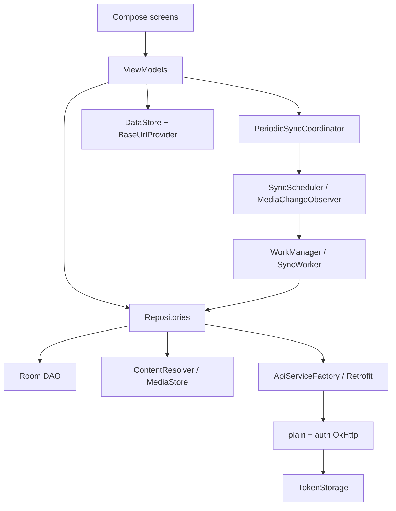

# Архитектура

Приложение состоит из одного Gradle module `:app`. Логические слои разделены пакетами, но не отдельными compilation modules. Compose screens используют ViewModels/StateFlow; ViewModels вызывают конкретные repositories и coordinator. SyncWorker напрямую оркестрирует media repositories. Отдельного domain/use-case слоя нет.

| Слой | Механизм и направление зависимости |
| --- | --- |
| Entry | App создаёт Hilt graph и предоставляет WorkManager Configuration/HiltWorkerFactory; MainActivity создаёт activity-scoped NetworkViewModel и UI |
| UI | NetworkScreen, AuthScreen, FilesScreen и две заглушки; NavHost стартует с network |
| Presentation | NetworkViewModel — URL/ping/bootstrap; AuthViewModel — форма/session actions; FilesViewModel — Room Flow, scan и work status |
| Repositories | Auth/Server обращаются к Retrofit; MediaFile связывает MediaStore snapshot с DAO; Checksum, Precheck и Upload меняют очередь |
| FolderRepository | Root/children lookup CAMERA, без cache |
| Persistence | AppDatabase → MediaFileDao → media_files; ServerPreferences → DataStore; TokenStorage → encrypted preferences |
| Network | ApiServiceFactory → Retrofit/Gson → plain/auth OkHttp; AuthInterceptor/TokenAuthenticator → TokenStorage и BaseUrlProvider |
| Background | Coordinator → Scheduler и Observer; Scheduler → WorkManager → SyncWorker |
| Status | SyncStatusStore — singleton StateFlow последнего результата, без persistence |

Hilt предоставляет singleton DB/DAO, HTTP clients, storage binding и repositories/coordinators. AppDatabase дополнительно использует собственный volatile/synchronized singleton. Authenticator удерживается singleton auth client; его lock не распространяется на login/logout.

MediaFile одновременно Room entity, repository result и элемент списка UI. AuthUiState зависит от presentation ConnectionStatus с Compose Color. FilesScreen содержит permission/bootstrap решение; NetworkViewModel отвечает за восстановление глобального сетевого адреса. Эти зависимости являются частью текущей модели.

Retrofit interfaces возвращают Java Call; execute блокирует поток, repositories используют Dispatchers.IO. Factory создаёт новый Retrofit/service при каждом вызове, upload — на каждый файл. Моста coroutine cancellation → Call.cancel нет.

Checksum, pre-check и upload имеют отдельные mutex. Scan и retry restore не используют их. Между SQL snapshot, HTTP и записью результата нет общей транзакции или проверки версии содержимого; подробности переходов — [09](09-state-model.md).

WorkManager инициализируется через Configuration.Provider; source manifest удаляет весь androidx.startup.InitializationProvider. Здесь не заявляется проверка merged manifest или генерации Hilt.

Version catalog используется для plugin aliases; фактические app dependencies заданы напрямую и не полностью совпадают с catalog. Неактивный дополнительный `app/AndroidManifest.xml` и каталог классов не используются для построения новой карты приложения. Конфигурация — [13](13-configuration.md).
