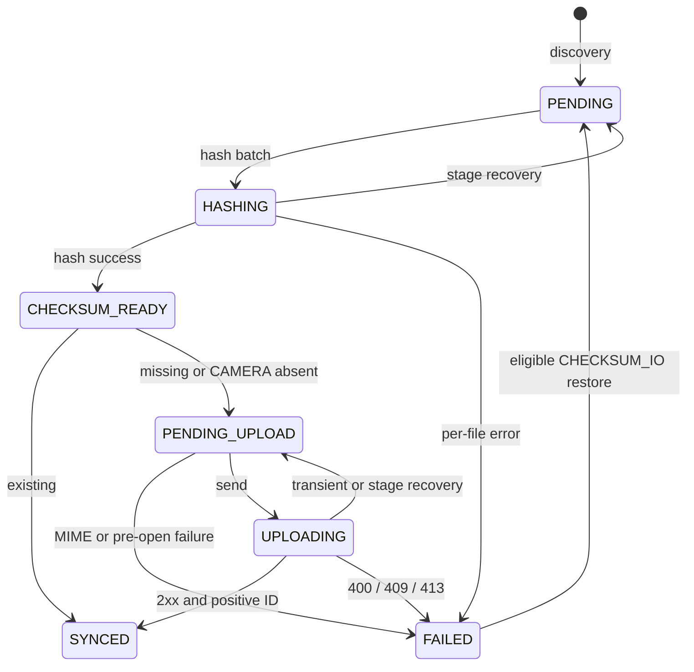

# State model

## Persisted state

| MediaFileStatus | Значение в обычном последовательном flow |
| --- | --- |
| PENDING | Строка ждёт hashing |
| HASHING | Persisted marker начатого hashing; может остаться после interruption |
| CHECKSUM_READY | Hash готов для pre-check |
| PENDING_UPLOAD | Очередь upload |
| UPLOADING | Persisted marker начатой отправки; может остаться без активного worker |
| SYNCED | Existing pre-check либо upload 2xx с id>0; ID optional |
| FAILED | Per-file failure; автоматический возврат ограничен CHECKSUM_IO |
| LOCAL_DELETED | UNUSED: enum/formatter есть, активного записывающего перехода нет |

HASHING и UPLOADING **хранятся в Room**. Они не являются только transient переменными, хотя описывают выполняемую операцию.

## Переходы

| Исходное состояние в snapshot | Событие/условие | Записанный результат |
| --- | --- | --- |
| Нет row | Новый MediaStore ID | PENDING; hash/ID/reason/time null,count0 |
| Любое | Size или mtime отличается | PENDING; clear hash/ID/reason/count/time |
| Любое | ID отсутствует в успешном snapshot | Row DELETE |
| HASHING | Вход checksum stage после permission guard | PENDING, только status |
| PENDING | Взята строка checksum batch | HASHING, только status |
| HASHING | Stream hash success | CHECKSUM_READY, hash, clear reason/count/time |
| HASHING | Null/FNF/Security/IO/other Exception | FAILED с соответствующей причиной,count++,time |
| FAILED | CHECKSUM_IO,count<3,time<=now−5min, выбран restore | PENDING, reason/time=null; count/hash/ID сохраняются |
| CHECKSUM_READY с hash | CAMERA отсутствует | PENDING_UPLOAD, status-only |
| CHECKSUM_READY с hash | Hash в existing | SYNCED, status-only, ID без изменения |
| CHECKSUM_READY с hash | Не existing, hash в missing | PENDING_UPLOAD, status-only |
| CHECKSUM_READY с hash | Нет hash в partition / запрос не завершён | Без записанного перехода для этой строки |
| UPLOADING | Вход upload stage | PENDING_UPLOAD, status-only |
| PENDING_UPLOAD | MIME не image/ | FAILED NOT_IMAGE,count++,time |
| PENDING_UPLOAD | Pre-open null/FNF/Security | FAILED FILE_NOT_FOUND/PERMISSION,count++,time |
| PENDING_UPLOAD | Guards успешны | UPLOADING |
| UPLOADING | 2xx и id>0 | SYNCED, serverFileId=id, clear reason/count/time |
| UPLOADING | 400/409/413 | FAILED HTTP_400/409/413,count++,time |
| UPLOADING | Прочий HTTP, IOException, invalid success ID | PENDING_UPLOAD; stop upload run |
| UPLOADING | Generic exception до записи результата / process death | Может остаться UPLOADING до recovery |
| PENDING_UPLOAD | Generic pre-open exception | Может остаться PENDING_UPLOAD; worker retry |

Исходное состояние таблицы — то, из которого caller выбирает запись; большинство UPDATE по ID не проверяет, сохранилось ли оно до write. Поэтому таблица не является SQL-enforced state machine.

Дополнительно из любого persisted состояния возможны content-change reset и stale DELETE. LOCAL_DELETED отсутствует на схеме намеренно.

## FailureReason

| Причина | Producer | Auto restore |
| --- | --- | --- |
| CHECKSUM_IO | IOException hashing после исключения FNF | count<3 и cooldown |
| FILE_NOT_FOUND | Hash null/FNF; pre-open upload null/FNF | Нет |
| PERMISSION | SecurityException hashing/pre-open | Нет |
| NOT_IMAGE | Upload local MIME guard | Нет |
| HTTP_400 | Upload HTTP 400 | Нет |
| HTTP_409 | Upload HTTP 409 | Нет |
| HTTP_413 | Upload HTTP 413 | Нет |
| UNKNOWN | Прочий Exception per-file hashing | Нет |

isRetryable true только CHECKSUM_IO, но selector использует конкретную причину, а не это свойство. FAILED без reason возможен после migration2→3. Transient upload не сохраняет FailureReason и не увеличивает retryCount.

SYNCED и прочие FAILED терминальны для обычной очереди, пока не произойдут content change/stale deletion; нет remote-event переходов и manual reset. Для CHECKSUM_IO count3 автоматический restore прекращается.

## Ограничения инвариантов

Нормальны SYNCED с null ID и PENDING/HASHING с ненулевым retryCount после restore. Schema не гарантирует hash/status/reason сочетания.

Два restore могут взять один FAILED snapshot. Первый worker восстановит и успешно вычислит hash; второй поздно выполнит resetFailedForRetry по ID. Получится PENDING с сохранённым non-null hash, возможно уже с server ID. Этот путь допустим кодом, но runtime interleaving не измерен.

Другой возможный путь: pre-check прочитал hashA; concurrent scan сбросил строку в PENDING/null hash; пришедший existing(hashA) записал status-only SYNCED. Возможны SYNCED/PENDING_UPLOAD с null hash. Сам этот пример **не** создаёт CHECKSUM_READY с null hash.

Status-only writes могут также перезаписать изменившуюся failure-строку, оставив reason при status!=FAILED. Отсутствие DB guards запрещает считать такие инварианты безусловными. Удалённая concurrent scan строка может получить upload response, после которого UPDATE по ID не обновит ничего.

## Derived/runtime state

WorkInfo RUNNING/ENQUEUED/BLOCKED принадлежит WorkManager, не MediaFile. Files isSyncing отслеживает только RUNNING photo_sync. SyncStatusStore хранит один in-memory outcome: SUCCESS, SERVER_UNAVAILABLE, ERROR, RETRY_SCHEDULED и timestamp.

Worker success/retry и file statuses независимы. SUCCESS может содержать FAILED; persisted HASHING/UPLOADING может существовать без RUNNING. PermissionDenied не обновляет последний SyncStatusRecord.
